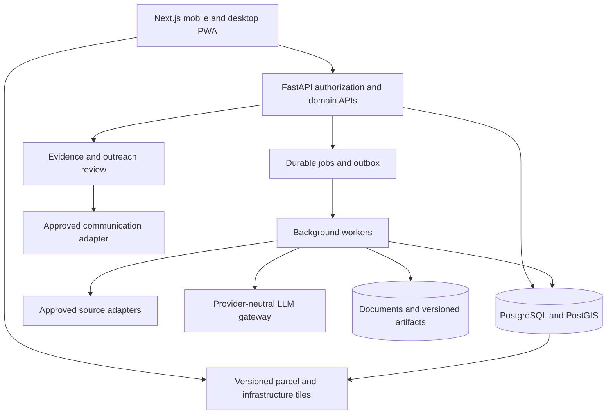
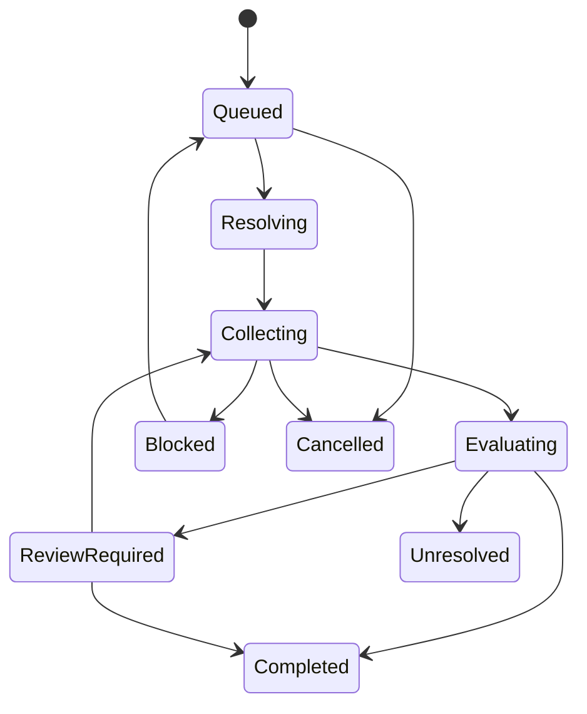

# CRE Intelligence and Powered Land Implementation Plan

> **For agentic workers:** REQUIRED SUB-SKILL: Use `superpowers:subagent-driven-development` (recommended) or `superpowers:executing-plans` to implement this plan task by task. Steps use checkbox (`- [ ]`) syntax for tracking. Read the embedded design and contracts before starting the task list.

**Goal:** Integrate a broad CRE research and operations platform with a mobile parcel explorer, evidence-backed LLC contact investigations, manual and automated land assemblages, and a specialized Powered Land screening lens.

**Architecture:** A modular FastAPI application owns authorization, canonical records, evidence, operations, and typed APIs. PostgreSQL/PostGIS is the authoritative store; background workers perform ingestion, investigations, screening, and report generation. A Next.js/MapLibre PWA serves cached parcel information separately from asynchronous research and versioned analytical results.

**Tech Stack:** Next.js, React, TypeScript, Yarn, MapLibre GL JS, Python, FastAPI, Pydantic, SQLAlchemy, Alembic, PostgreSQL/PostGIS, Celery/Redis, S3-compatible storage, and a provider-neutral LLM adapter. Preserve compatible existing repository choices. No graph database, separate vector database, native mobile application, or microservice decomposition is required.

**Spec:** The embedded design in Sections 1–10 of this file is the implementation specification. The task plan implements that design and the CRE/Powered Land requirements developed in this conversation; the earlier chat is not required to execute it.

**Owner:** JT / Synapse Faster. **Prepared:** November 23, 2026. **Document version:** 1.0.

**Suggested repository destination:** `docs/superpowers/plans/2026-11-23-cre-intelligence-powered-land.md`.

**Status:** Implementation plan prepared; application implementation, source imports, migrations, and product tests have not been run as part of producing this document. No target repository was supplied for inspection. All application paths below are proposed paths until Task T00 maps them to the actual repository.

## Global Constraints

- Preserve the broad CRE product. Powered Land is a specialized lens on shared property, ownership, and operations data.
- Use a mobile-first web application that also works on desktop and iPad. Start with one configured Georgia county; Gwinnett is the default engineering fixture, not an assertion that it is the best data-center market.
- Preserve existing compatible code, migrations, package managers, authentication, and deployment. Do not scaffold a second application beside working code.
- Internal UUIDs identify entities; original source identifiers, leading zeros, jurisdiction, and historical aliases remain intact.
- Parcel, property, building, space, party, ownership interest, prospect, and proposed assemblage are distinct concepts.
- Every material research assertion has source support, dates, verification state, and permitted audience. Unknown is a valid result.
- Same address, registered agent, organizer, or surname is not evidence of common control or beneficial ownership.
- Display `Screened area remaining`, not `Net buildable acres`, for the automated hazard-subtraction calculation. A separately sourced engineering estimate may use its actual professional designation.
- Display power/fiber proximity separately from confirmed capacity, serviceability, cost, and delivery dates.
- Use deterministic code for spatial measurement, finance, matching rules, and score arithmetic. An LLM may extract, propose, investigate, and explain.
- Enforce tenant isolation on APIs, SQL, workers, object storage, caches, search, exports, and relationship traversal.
- License/access decisions are action-specific. A public endpoint does not grant automatic rights to cache, redistribute, export, or send its data to an external LLM.
- Store immutable versions only for their permitted retention period; support deletion and downstream invalidation when policy requires it.
- User-approved outbound communications are a separate subsystem. No automatic messages are sent merely by selecting a parcel or running research.
- Pin compatible dependency versions during T00/T01 and commit lockfiles. This document intentionally does not claim a particular package release is the latest.
- Routine reversible implementation is authorized when this plan is handed to an implementer. Real purchases, external messages, access exceptions, and production publication require whatever explicit authorization is applicable at execution time.

## Review Focus

1. **Late results after selection or tenant change:** a parcel A response must never overwrite parcel B or expose a prior workspace's results. Tests: T02, T12, T13.
2. **Incomplete, stale, or revoked datasets:** absence of hazards or owners must remain unknown when coverage is incomplete; revoked evidence must disappear from derived outputs. Tests: T07, T17, T18, T33.
3. **False ownership consolidation:** identical names, shared agents, co-owners, trustees, and corporate managers must not collapse into an invented principal. Tests: T03, T14, T21, T22, T26.
4. **Spatial edge cases:** point contacts, overlapping hazards, road-separated parcels, sliver geometry, and wrong CRS units must not produce fictitious usable sites. Tests: T15, T18, T19, T24, T25.
5. **Retries and partial failures:** duplicate jobs, offline writes, report exports, and send retries must not duplicate side effects or publish partial snapshots. Tests: T05, T07, T09, T13, T23, T32.

---

## Contents

1. [How to use this plan](#1-how-to-use-this-plan)
2. [Product scope and feature traceability](#2-product-scope-and-feature-traceability)
3. [Architecture and integration boundaries](#3-architecture-and-integration-boundaries)
4. [Canonical schema and migration rules](#4-canonical-schema-and-migration-rules)
5. [Source provisioning and acquisition contracts](#5-source-provisioning-and-acquisition-contracts)
6. [Spatial analysis and discovery contracts](#6-spatial-analysis-and-discovery-contracts)
7. [Ownership, contact, and outreach contracts](#7-ownership-contact-and-outreach-contracts)
8. [Mobile workflows and operational behavior](#8-mobile-workflows-and-operational-behavior)
9. [Typed APIs, jobs, and shared contracts](#9-typed-apis-jobs-and-shared-contracts)
10. [Release gates and implementation order](#10-release-gates-and-implementation-order)
11. [Detailed implementation tasks](#11-detailed-implementation-tasks)
12. [Acceptance scenarios and deployment runbook](#12-acceptance-scenarios-and-deployment-runbook)
13. [Effort, operating costs, and decisions](#13-effort-operating-costs-and-decisions)
14. [Coding-agent handoff and resume instructions](#14-coding-agent-handoff-and-resume-instructions)
15. [Primary sources and verification boundaries](#15-primary-sources-and-verification-boundaries)

## 1. How to use this plan

This is a complete implementation handoff, not a request to start every feature simultaneously. The release gates produce useful software progressively, while the coverage matrix keeps later features visible.

When back at the computer:

1. Save this file at the suggested repository destination, or another path the project already uses for implementation plans.
2. Give the coding agent the handoff prompt in Section 14.
3. Execute T00 first. It identifies what already exists, checks local instructions, maps proposed files to real modules, and records baseline test failures.
4. Execute only the next dependency-ready task. Review its result, record real verification evidence, and continue.
5. Use synthetic fixtures until each live source has an approved access method and a verified mapping. A blocked optional source must not block unrelated work.
6. At each release gate, run the relevant cross-module scenarios and review the running product on a phone.

All features requested in the discussion are mapped below. Features requiring external information still get data models, interfaces, manual-intake workflows, and visible coverage states; the application must not fabricate the unavailable underlying data.

### 1.1 Design decisions being carried forward

The existing direction is a modular monolith with PostgreSQL/PostGIS, FastAPI, a provider-neutral LLM layer, and a Next.js map interface. This plan makes the map mobile-first, adds a proper assemblage/analysis domain, and shares the same property foundation across broker, investor, developer, and asset-manager workflows.

Three approaches were considered: a separate data-center product, a broad platform rebuilt around many services, and shared CRE foundations with specialized lenses. The plan uses the third because ownership research, field capture, site analysis, and prospect operations reuse the same entities. This is a proposed implementation choice consistent with the prior design, not a claim that a repository already implements it.

### 1.2 What requires validation during execution

Source endpoints, licensing, actual county schemas, existing repository state, chosen imagery provider, authentication deployment, and the first live pilot county remain execution-time checks. These do not require reopening the product design. Resolve them through T00 and the relevant source-activation tasks; record the result and proceed with the permitted fallback.

## 2. Product scope and feature traceability

**Core workflow:** locate a property on a phone → inspect county facts → investigate the legal owner → assemble neighboring tracts → screen site constraints and infrastructure → record a CRE opportunity → produce a cited dossier → prepare an authorized next action.

| ID | Feature | Required behavior | Owning tasks |
|---|---|---|---|
| F01 | Canonical CRE foundation | Parcels, multi-parcel properties, buildings, spaces, ownership history, source evidence | T03–T08 |
| F02 | Address/APN/map/entity search | Jurisdiction-aware matching; ambiguity shown; boundary-safe selection | T03, T10 |
| F03 | Mobile map | Satellite basemap option, vector parcels, Locate Me, accuracy circle, list fallback | T10–T12 |
| F04 | Two-stage parcel drawer | Immediate available facts; independent one-tap ownership research; source dates | T12, T21 |
| F05 | Saved field work | Colored folders/pins, notes, photos, visits, directions, limited offline sync | T13 |
| F06 | Sibling-parcel halo | Separate same-entity, same-mailing-address, documented-control modes | T14 |
| F07 | Manual assemblage stack | Select/remove tracts, union area, assess connectivity, deduplicate known owners | T15, T18, T26 |
| F08 | Lens switcher | Standard CRE / Powered Land; preserve selection and map position | T20 |
| F09 | Transmission and substations | Voltage-qualified geometry, nearest qualifying infrastructure, coverage and date | T16, T19 |
| F10 | Utility territories | Source-qualified boundaries; utility confirmation workflow; no automatic supplier eligibility | T16, T19 |
| F11 | Environmental screen | FEMA/NWI overlays, overlap-safe excluded area, remaining area, uncertainty | T17–T18 |
| F12 | Fiber and transportation | Rail/highway corridor proximity; separately verified fiber routes/serviceability | T16, T19 |
| F13 | Local development context | Zoning/uses, permits, moratoria, residential adjacency, access, water/wastewater | T16, T19, T29 |
| F14 | Multi-hop LLC research | Documented entity relationships; role distinctions; bounded research; unresolved outcomes | T08, T21 |
| F15 | Professional contacts | Identity, role, and channel verification; appropriate organizational route if no principal | T22 |
| F16 | Necessary outreach | Draft, recipient review, approval, suppression, dispatch adapter, delivery audit | T23 |
| F17 | County-wide assemblage radar | Constrained connected search; source filters; explainable candidate generation | T24–T25, T27 |
| F18 | Assemblage friction | Recorded-owner and negotiation-group counts with unresolved cases; interpretable research score | T26 |
| F19 | Readiness and suitability | Independent screening metrics, due-diligence status, and capacity evidence | T19, T26 |
| F20 | Broad CRE operations | Portfolios, prospect/roster boards, opportunities, tasks, activities, documents | T28 |
| F21 | Leasing and asset register | Customer-uploaded rent rolls, tenants, lease dates, expiries, operating observations | T29 |
| F22 | Agency-of-record and reverse matching | Evidence-dated agency role; match property to buyer criteria and explain why | T22, T30 |
| F23 | Market and transaction research | Deeds, assessments, user/licensed comps, geography-qualified demographics/vacancy/supply observations | T06, T08, T29–T31 |
| F24 | Basic underwriting | Versioned assumptions, deterministic NOI/cap-rate/DSCR/sensitivities | T31 |
| F25 | Site and ownership dossier | One-page executive report plus evidence appendix; reproducible and permission-filtered | T32 |
| F26 | Change monitoring | Source changes, saved screens, lease deadlines, review tasks, opt-in notifications | T27, T33 |
| F27 | iPad/show demonstration | Separate demo tenant, prepared sites, source labels, controlled dossier delivery | T34 |
| F28 | Reliable multi-tenant product | Authorization, audit, cost budgets, observability, backups, restore, deployment | T01–T02, T09, T35–T36 |
| F29 | Pilot validation | Five difficult owner cases and top three qualified screening candidates or fewer with reasons | T36 |
| F30 | Three-to-five-county expansion | Per-county adapters; cross-border candidates and source coverage; quality-gated rollout | T37 |

**Explicit product boundaries:** full property accounting, legal title certification, engineering buildability certification, guaranteed grid/fiber capacity, mass autonomous solicitation, native apps, and full institutional underwriting are not delivered by these features. Their integration points are retained without implying the work has been completed.

## 3. Architecture and integration boundaries



### 3.1 Module responsibilities

| Module | Responsibilities | Boundary |
|---|---|---|
| Identity | Tenants, memberships, roles, authorization context | Every operation carries validated context |
| Provenance | Dataset catalog, source policy, snapshots, receipts, run attempts, source records | Acquisition and permitted uses are explicit |
| Evidence | Typed assertions, support, review, conflicts, selected projections | An LLM cannot directly overwrite selected facts |
| Parcels/properties | Stable IDs, geometry versions, property grouping, search | Authoritative full geometry remains server-side |
| Analysis | Assemblages, hazards, infrastructure distances, adjacency, radar, scores | Outputs pin exact input versions and assumptions |
| Research | Investigations, typed tools, budgets, state machine, resumable steps | Read/research tools separated from external writes |
| Contacts/communications | Business contact routes, role evidence, suppressions, reviewed messages | Discovery is independent from sending |
| Operations | Portfolios, roster, opportunities, tasks, notes, leasing, buyer mandates | Tenant-owned operational state |
| Reports | Snapshots, executive page, evidence appendix, export policy | Historical figures reproducible; permissions checked at download |

Use relational tables for ownership edges and bounded recursive queries. Add vector search only if document retrieval evaluation demonstrates a need; keep it in the same PostgreSQL instance through pgvector if adopted. No vector search result establishes a corporate relationship.

### 3.2 Proposed repository map

| Path | Purpose |
|---|---|
| `apps/web/src/app/` | Next.js routes and authenticated application shell |
| `apps/web/src/features/map/` | MapLibre, parcel selection, layers, GPS |
| `apps/web/src/features/parcels/` | Two-stage drawer and property profile |
| `apps/web/src/features/field/` | Saved folders, notes, photos, offline outbox |
| `apps/web/src/features/assemblages/` | Manual selection and site analysis |
| `apps/web/src/features/research/` | Investigation progress and evidence review |
| `apps/web/src/features/radar/` | Screening editor and candidate results |
| `apps/web/src/features/operations/` | Boards, portfolios, activity, leasing, mandates |
| `apps/web/src/features/reports/` | Dossier preview and exports |
| `apps/web/src/lib/api/generated.ts` | Generated OpenAPI client/types; never hand-edit |
| `services/api/src/cre/contracts/` | Pydantic request/response contracts, enums, shared IDs |
| `services/api/src/cre/identity/` | Authentication integration, tenancy, permissions |
| `services/api/src/cre/provenance/` | Source catalog, permissions, ingestion metadata |
| `services/api/src/cre/evidence/` | Assertion ledger, review, projections |
| `services/api/src/cre/sources/` | Acquisition adapters and normalization |
| `services/api/src/cre/parcels/` | Canonical parcel/property services and search |
| `services/api/src/cre/analysis/` | Spatial algorithms, radar, scoring |
| `services/api/src/cre/research/` | Investigation orchestration and tool registry |
| `services/api/src/cre/contacts/` | Identity-role-channel evidence and contact ranking |
| `services/api/src/cre/communications/` | Approval and dispatch state machine |
| `services/api/src/cre/operations/` | CRE workflows and financial scenarios |
| `services/api/src/cre/reports/` | Versioned report payloads and rendering |
| `services/worker/src/cre_worker/` | Worker entrypoints; calls domain services rather than duplicating them |
| `services/api/alembic/versions/` | Forward database migrations |
| `contracts/manifests/` | Source manifests and per-county field mappings |
| `contracts/schemas/` | Generated JSON schemas and API snapshots |
| `tests/fixtures/`, `tests/integration/`, `tests/spatial/`, `tests/e2e/` | Deterministic datasets and substantive tests |
| `infra/compose.yaml`, `infra/deploy/` | Local services and deployment configuration |
| `docs/adr/`, `docs/runbooks/`, `docs/superpowers/` | Decisions, operations, implementation ledger |

These paths are a contract for a new repository and a mapping guide for an existing one. T00 creates `docs/implementation-map.md` listing each proposed path and its actual equivalent. Subsequent tasks use that mapping.

### 3.3 Execution and delivery choices

- Local development uses containerized PostGIS and object storage, with the web/API running natively or in containers according to the repository. Redis/Celery workers are added when T09 requires them.
- PostgreSQL persists job state and an outbox. Redis transports work; losing Redis cannot erase accepted jobs or completed evidence.
- Static, approved-for-distribution geometry can become versioned PMTiles archives. Publish freely downloadable archives only when terms permit downstream copies that cannot be recalled; otherwise use policy-checked authenticated delivery. Dynamic/private overlays remain authenticated API/MVT responses. PMTiles is a read-only archive format using range requests, so updates publish a new archive rather than mutate it in place. [S13]
- The satellite basemap is a separately licensed provider choice. MapLibre and parcel vector tiles do not provide imagery rights.
- Public datasets and private workspace data have distinct caches. Private contact, opportunity, and research details never enter a globally cacheable tile archive.
- The LLM adapter supports configured remote providers and optional local endpoints. A model name, endpoint, context size, or structured-output ability must be validated by adapter capability tests; no provider-specific assumption enters domain services.

## 4. Canonical schema and migration rules

### 4.1 Data domains

| Schema | Principal tables | Important invariants |
|---|---|---|
| `identity` | `tenant`, `membership`, `data_scope` | One global scope plus tenant scopes; no nullable-tenant uniqueness loopholes |
| `core` | `object`, `jurisdiction`, `parcel`, `parcel_identifier`, `parcel_lineage`, `parcel_geometry_version`, `property`, `property_parcel`, `building`, `space` | Typed object IDs; county-qualified identifiers; historical geometry |
| `core` | `party`, `entity_registration`, `party_name`, `party_relationship`, `ownership_interest` | Registry IDs scoped to issuing jurisdiction; multiple concurrent owners allowed |
| `provenance` | `source_system`, `dataset`, `source_policy_version`, `dataset_snapshot`, `acquisition_receipt`, `source_record`, `ingestion_attempt` | Versioned permissions, content, and acquisition history are distinct |
| `evidence` | `claim`, `claim_support`, `claim_review_event`, `projection_selection`, `projection_generation`, `active_generation`, `conflict` | Immutable assertions/reviews; reader generations pin all participating snapshots and selections |
| `analysis` | `assemblage`, `assemblage_member`, `assemblage_version`, `layer_version`, `infrastructure_feature`, `hazard_feature`, `coverage_region` | Proposed assemblages do not merge legal parcels or properties |
| `analysis` | `analysis_run`, `analysis_dependency`, `site_metric`, `adjacency_build`, `adjacency_edge`, `radar_run`, `candidate`, `score_profile` | Every result pins geometry, source, policy, and algorithm versions |
| `research` | `investigation`, `investigation_step`, `tool_receipt`, `review_task` | Durable state; cost and depth limits; abstention outcomes |
| `contacts` | `contact_point`, `role_assertion`, `channel_verification`, `suppression` | Role, entity, and channel support evaluated independently |
| `communications` | `message_draft`, `approval`, `send_attempt`, `delivery_event` | Approval bound to exact payload, recipient, sender, attachments, and current policy |
| `operations` | `portfolio`, `portfolio_member`, `folder`, `saved_parcel`, `prospect`, `prospect_subject`, `opportunity`, `opportunity_subject`, `task`, `activity`, `field_note`, `photo` | Tenant scope and optimistic revision checks; a prospect may exist before any opportunity |
| `operations` | `lease`, `tenant_occupancy`, `financial_observation`, `analysis_scenario`, `comparable`, `buyer_mandate`, `agency_role`, `match_result` | Source period and assumptions explicit; no fabricated financial data |
| `jobs` | `job`, `job_event`, `outbox`, `idempotency_record`, `usage_event` | At-least-once processing; effect deduplication and bounded retries |
| `reports` | `report_snapshot`, `report_dependency`, `export_event` | Immutable calculated payload; current authorization at retrieval |

### 4.1.1 Required attribute dictionary

Implement these names in typed contracts even when a source leaves their values null. Observed values attach evidence/period/unit metadata rather than becoming unexplained scalar truths.

| Object | Essential attributes beyond ID/scope/history |
|---|---|
| Parcel | `jurisdiction_id`, identifiers, situs address, geometry version, source land-use code, source/deeded acreage, measured acreage, assessor ownership interests |
| Property | `name`, `asset_class`, `asset_subtype`, provisional/verified grouping state, parcel memberships, primary address |
| Building | `property_id`, footprint if available, gross/rentable area with units, `year_built`, `year_renovated`, building/use class, condition observation, floors, parking observations |
| Space | `building_id`, unit/suite label, area and basis, permitted use, occupancy status with as-of date |
| Party/registration | person/organization kind, display/legal names, registry jurisdiction/number, status, aliases and evidence; no guessed person from a name-only match |
| Ownership interest | subject parcel/property, party, interest kind, instrument reference, share if stated, effective/known dates, source and review state |
| Prospect | tenant, typed subject links, optional target party, purpose, source, assigned user, `new/researching/qualified/disqualified/archived`, next action; optional linked opportunities |
| Infrastructure | kind, geometry version, owner/operator if reported, voltage or service attributes with units, reported status, source/coverage dates; no inferred capacity |
| Diligence record | subject/use/jurisdiction, topic, statement, source section/document, applicability/effective dates, reviewer, status, next action |
| Financial/market observation | typed property or geography subject, metric, decimal amount/value, unit/currency, time period, aggregation basis, source/assumption status, geographic granularity |

Source-specific extras remain in versioned typed observations or preserved payloads. Do not turn every county field into an ungoverned top-level property column.

### 4.2 Identity and tenant rules

Use `core.object(id UUID, object_kind, scope_id)` as a typed reference supertype, with subtype tables enforcing `(id, object_kind, scope_id)` references. This avoids an unconstrained `subject_type + subject_uuid` pair that can point to nothing. A parcel may be shared reference data; a tenant's proposed grouping, contact discovery, notes, and relationship evidence remain tenant-scoped.

Shared geometry does not imply shared enrichment. Queries may combine permitted reference facts with the requesting tenant's facts. They must not combine private edges from multiple tenants into one graph or leak their existence through counts, scores, caches, or error messages.

Typed foreign keys establish existence, but scope compatibility needs an additional enforced rule: tenant rows may reference their own scope and explicitly allowed global types; global rows may reference only global endpoints. A tenant-local selection may override the displayed global selection for that tenant after a review, while preserving the global finding and any conflict. It cannot change the shared selection. Source audience and licensing checks remain independent of workspace membership.

Database row-level security supplements service authorization. Runtime roles must not own the tables or bypass RLS. A worker resolves tenant and actor from the persisted job and rechecks current permission; it never trusts a client-supplied tenant ID alone.

### 4.3 Parcel, property, geometry, and ownership

- Parcel identity is jurisdiction plus source-qualified identifier history, not one globally unique APN string. An `OBJECTID` is a source-local retrieval identifier, not a durable legal parcel identifier.
- Preserve `raw_identifier`, `normalized_identifier`, `namespace`, `valid_from/to`, and source. Normalization must not strip meaningful suffixes or collapse lots with distinct assessor identifiers.
- Parcel splits/merges create predecessor/successor edges in `parcel_lineage`. Absence from an incomplete snapshot does not retire a parcel.
- `property_parcel` has an interval and role. Do not create a supposedly verified commercial property automatically for every parcel; create a provisional grouping only when needed, with provenance.
- Store full-resolution geometry versions in SRID 4326 plus declared input CRS and transformation metadata. Display simplification is derived and never used for area or adjacency calculations.
- A current geometry selection is singular per parcel and scope, but competing geometry versions remain available. Publish the pointer atomically.
- Ownership interests are source-asserted legal or assessor interests. The schema allows co-owners, partial interests, unknown percentages, and different instrument/effective dates.
- Do not enforce one current owner per parcel. Do not infer 100% ownership from the only known name or classify a grantor/grantee record alone as a title certification.
- Multiple LLCs sharing an individual manager may still require separate signatories or approvals. Keep legal-owner count separate from documented negotiation-group count.

### 4.4 Evidence contract

`claim` includes `id`, `scope_id`, typed `subject_id`, controlled `predicate`, schema-validated `value`, `effective_from/to`, `observed_at`, immutable platform `recorded_at`, `extraction_method`, and `supersedes_claim_id`. Support records include exact source record, field/page/span locator, and provenance lineage. Reviews and projection selections are separate append-only events, each with its own platform `recorded_at` for historical known-time queries.

Use verification states `unresolved`, `candidate`, `corroborated`, `verified`, `conflicted`, `stale`, `rejected`, and `revoked`. A state describes support for the precise predicate, not universal truth. A verified `registered_agent_for` relationship remains irrelevant to a `beneficial_owner_of` assertion unless separate evidence supports that claim.

Track effective time, observation time, retrieval time, and verification time separately. Fetching unchanged bytes can create a new acquisition receipt; reusing a cached hash cannot establish fresh verification. Retain original publication/update dates where known.

Historical reads accept `effective_at` and `known_at` to distinguish what allegedly applied then from what the system knew then. Reports pin actual selected claims and versions, not just a timestamp and a later re-query.

Each user-facing property/parcel read pins one `projection_generation_id`, which names the geometry and ownership snapshots, selected claims, and applicable policies. A raw dataset may be accepted before its derived projection is ready, but the reader-visible generation stays on the prior consistent set. Late projection events cannot regress the active generation. Tiles and summary responses carry their generation/version so stale tiles can be refreshed instead of silently mixed with incompatible parcel identities.

### 4.5 Migration strategy

The prior chat SQL was a design sketch and must not be executed verbatim as an existing migration. Use new reviewed Alembic revisions for the actual repository:

1. Add foundational scopes and versioned tables without destructive replacement.
2. Backfill from existing fields using documented mappings and explicit `unknown` status.
3. Validate counts, foreign keys, tenant ownership, temporal overlap rules, and parcel identity collisions.
4. Switch reads through a feature flag or compatibility view.
5. Remove obsolete fields only in a later explicitly authorized migration after rollback and backup validation.

Migration identifiers are assigned from the real repository head. Do not invent or overwrite an existing `0001` migration. Large published datasets use immutable snapshot tables plus an atomic active-version pointer rather than one enormous row-by-row publication transaction.

## 5. Source provisioning and acquisition contracts

### 5.1 Initial source register

The links in Section 15 are discovery/documentation references. They are not a guarantee of access, live API availability, field mappings, or redistribution rights. At activation, inspect the current provider response and record the exact endpoint/schema/license evidence.

| Source class | Planned use | Activation evidence | Fallback |
|---|---|---|---|
| Gwinnett GIS/assessor | Parcel boundaries, original IDs, county facts, assessor-listed owner, assessment period | Current metadata, actual sample, join-key validation, permitted uses | Authorized file import |
| Gwinnett ownership export | Separate XLSX ownership/value enrichment | Workbook sheet/header inspection and published snapshot date | Manual mapped import; no guessed column names |
| GSCCCA | Deed/index/document research | Authorized access method and retained reference permissions | Analyst-uploaded records |
| Georgia SOS | Legal-entity identity and disclosed roles | Current registry fields and permitted acquisition path | Analyst lookup/document import |
| Transmission/substations | Geometry/voltage screening | Current official or licensed source, dates, completeness and rights | Layer unavailable; no fabricated nearest substation |
| Georgia utility context | Territory/corridor context and utility correspondence | Authoritative map provenance plus separate eligibility confirmation | Reference document/manual assessment |
| FEMA NFHL | Selected mapped flood-hazard categories | Effective source version, coverage, zone mapping | Unknown/unmapped status |
| USFWS NWI | Reconnaissance wetland/water mapping | Project metadata, imagery dates, coverage and classification | Unknown coverage; professional study upload |
| Rail/highway | Transportation distance and corridor proxy | Current official geometry, class codes and dates | Disable proxy metric |
| Local planning/public works | Zoning, permits, restrictions, residential context, water/wastewater | Jurisdiction, ordinance effective date, use definition, source evidence | Manual research tasks/documents |
| Census geocoder / ACS | Address candidates/census geography and area-level demographic context | Benchmark/vintage, geography IDs, variables, observation periods, and mapping | Existing county address search; manual geography-qualified observations |
| EPA ECHO | Nearby regulated-facility/compliance context | Query/bulk feed, facility IDs, program/status dates, coverage and source limitations | Reference-only environmental diligence task |
| Fiber operators | Verified serviceability, routes, diverse paths | Provider evidence and allowed display scope | Rail/highway proxy only, clearly labeled |
| Customer/licensed data | Rent rolls, leases, comps, operating statements, contact channels | Tenant authorization and provider permissions | Manual entry with provenance |
| Imagery provider | Satellite basemap | Attribution, token restrictions, caching/print/offline license | Approved street/vector basemap |

Gwinnett's ownership page describes a quarterly ZIP/XLSX distribution; it does not establish the current workbook's columns. [S01] Georgia's registered-agent description does not establish beneficial ownership, and public LLC records do not guarantee access to a manager or principal. [S02] Avoid dependence on a beneficial-owner registry or a future legal rule mentioned in previous conversational examples.

### 5.2 Machine-readable manifest

The manifest schema distinguishes a blocked configuration from a valid production connector. Nulls below are explicit activation dependencies, not instructions to guess them.

```yaml
manifest_version: "1.0"
dataset_id: "ga_gwinnett_parcels"
publisher: "Gwinnett County"
scope: "reference"
jurisdiction_fips: "13135"
status: "draft"
source:
  discovery_url: "https://www.gwinnettcounty.com/government/departments/information-technology-services/geographic-systems/gis-browser"
  acquisition_method: "approved_file_import"
  endpoint: null
  metadata_checked_at: null
identity:
  namespace: "ga:13135:assessor"
  primary_field: null
  aliases: []
  normalization_version: "gwinnett-pin-v1"
mapping:
  version: "1"
  schema_fingerprint: null
  geometry_field: null
  input_srid: null
  field_map: {}
coverage:
  mode: "full_snapshot"
  expected_area: "county"
  footprint_object: null
  complete: false
policy:
  version: "1"
  acquire: "pending"
  retain_raw: "pending"
  cache_online: "pending"
  internal_display: "pending"
  derive: "pending"
  local_llm: "pending"
  hosted_llm: "pending"
  export: "pending"
  redistribute: "pending"
  offline_cache: "pending"
  attribution: null
  evidence_reference: null
  expires_at: null
refresh:
  mode: "manual"
  stale_after_days: null
```

`pending` never authorizes an action. Approval may be based on published terms or an existing contract; the product should not invent a new permission request when rights are already established. Capture that evidence and allow only the permitted actions. Manual acquisition is not a workaround for prohibited retention or redistribution.

Enforce expiry/revocation on reads, cache delivery, object downloads, LLM submission, and exports from the first live release. A minimal purge process is required before admitting expiring/revocable retained bytes; otherwise that source stays fixture-only. Deliver sensitive revocable objects through policy-checked routes or tightly bounded download grants. Already delivered copies and a legitimately offline device cannot be instantly recalled; do not promise that they can.

### 5.3 Ingestion contract

1. **Authorize:** resolve source policy for the precise action and tenant.
2. **Acquire:** write an acquisition receipt with endpoint/file, retrieval result, pagination strategy, source version, and declared coverage.
3. **Preserve:** store original bytes or permitted source references, checksum, and retention deadline. Never commit secrets or raw customer data to Git.
4. **Stage:** parse typed records; preserve raw values and mapping version; reject unknown critical fields.
5. **Validate:** validate structure, geometry, jurisdiction, keys, pagination completeness, duplicate keys, and unexpected distribution changes.
6. **Resolve:** map stable source identifiers to canonical objects. Fuzzy names/addresses produce candidates, not merges.
7. **Prepare:** create versioned observations, claims, geometry, and change proposals in an unpublished snapshot.
8. **Publish:** freeze and validate the candidate manifest, recheck current source permission, and compare expected snapshot and reader-generation pointers under the publication transaction. Advance the reader generation only when its geometry/claim projections are complete, and commit the outbox event atomically. Readers see either the old or new complete generation.
9. **Invalidate:** mark downstream affected analyses stale and enqueue work within budgets.
10. **Reconcile:** publish counts, quarantine reasons, source dates, newly missing records, and review tasks.

An ingestion attempt and dataset content version are separate. Failed attempts may retry the same content/mapping. Successful replay must not duplicate canonical records. Missing records in a partial extraction cannot cause mass retirement.

For ArcGIS, first inspect query capabilities. Prefer an authorized stable object-ID list with bounded batches, or supported pagination with deterministic ordering, explicit limits, and start/end consistency checks. A maximum-record limit is not permission to assume one request returns the county. If the service cannot provide a consistent live snapshot, label acquisition consistency and use an approved export for authoritative publication.

For ZIP/XLSX/PDF intake, enforce archive traversal protection, decompression/row/page limits, file signature checks, no macro/formula execution, and document access controls. Schema changes quarantine the affected dataset until mapping is reviewed.

Optional enrichments use the same manifest/admission pipeline. Census geocoder results are address-location candidates, not authoritative parcel boundaries; record the selected benchmark/vintage. ACS observations remain tied to their reported geography/period and uncertainty where supplied, not assigned as precise parcel facts. EPA ECHO provides facility/compliance query services and separate bulk downloads; proximity or a facility record is not a Phase I environmental assessment or proof of parcel contamination. [S17], [S18], [S19] Vacancy, absorption, rents, traffic, and development-pipeline metrics require dated user/licensed/public observations with the actual geography and definition; unknown fields stay unknown.

## 6. Spatial analysis and discovery contracts

### 6.1 Measurement policy

Store canonical geometries in EPSG:4326. For measured distances, use PostGIS geography in meters or an explicitly configured suitable projected CRS. `ST_DWithin` on geometry uses the CRS's units; on geography it uses meters. Do not compare a one-mile threshold to longitude/latitude degrees. [S11]

Use a configured metric analysis CRS for topology, buffering, and intersection; record that CRS, precision policy, and transformation version. For the Georgia pilot, EPSG:5070 is a proposed equal-area analysis CRS; validate it and its tolerances in the adapter before activation. Publish areas using a declared consistent method, with geography-based area in square meters as the reference measurement. `ST_Area` on geography is square meters. [S12]

Constants: one international acre is `4046.8564224` square meters; one international mile is `1609.344` meters. Store meters, square meters, kV, and MW internally. Keep source-reported deeded acreage and measured polygon acreage as separate observations.

`ST_SetSRID` labels coordinates; it does not transform them. Unknown CRS blocks analysis. Invalid geometry enters quarantine or an explicit, logged repair path that retains the original. Display tiles may simplify polygons, but analysis always uses the accepted full-resolution version.

### 6.2 Assemblage calculations

Manual assemblages accept 1–20 distinct parcels in the pilot; the user can readily select the 3–6 tracts discussed. The upper bound is configurable and protects interactive computation. Automated search uses a separate, smaller bound.

For member geometries `P_i`, calculate the union `P = union(P_i)` before area, perimeter, hazard overlay, or proximity. Return:

- Measured union area, separately summed source-reported acreage, and per-parcel geometry/source versions.
- Member count, connected component count, point-only contacts, and any crossing/barrier flags.
- Distinct recorded legal-owner count, unresolved ownership count, and documented negotiation groups where supported.
- Comparable-period assessed values with the assessment year and aggregation coverage. If years or currencies differ, show grouped totals; do not publish a misleading combined sum.
- Current research/contact status for each owner interest, without duplicate enrichment charges for an already-resolved entity in the same permitted scope.

A saved assemblage has immutable membership revisions. It does not alter parcel identity, title, property boundaries, or the user's selected parcels without an explicit edit.

### 6.3 Environmental screening

Let `F` be the selected effective mapped flood-hazard polygons, `W` the selected NWI wetland/water polygons, and `B` any explicitly configured additional screening buffers. Compute:

```text
excluded_geometry = intersection(P, union(F, W, B))
remaining_geometry = difference(P, union(F, W, B))
gross_area_m2 = measured_area(P)
known_excluded_area_m2 = measured_area(excluded_geometry)
screened_remaining_area_m2 = measured_area(remaining_geometry)
```

Union all exclusions before subtraction; overlapping wetlands and flood polygons count once in the combined exclusion. Also return each individual overlap for transparency, but label those category totals as non-additive.

The pilot policy includes effective FEMA special-flood-hazard polygons and mapped NWI wetlands/deepwater polygons, using verified provider classification mappings. Preliminary and pending flood products are separate scenarios. FEMA distinguishes these products and their effective status. [S06] NWI is reconnaissance mapping and is not a jurisdictional wetland determination. [S07]

When required coverage is incomplete, return `screened_remaining_area_m2 = null`, `status = incomplete`, known intersections, and coverage percentages. Definitive largest-remaining-component area, remaining component count, and pad/width feasibility are also null; a known-region diagnostic must be labeled as partial. An empty hazard query does not mean zero constraints unless the dataset positively covers the site. Never substitute zero for missing wetland, flood, zoning, slope, or infrastructure information.

For complete required coverage, return largest remaining polygon component, component count, and a stated shape/width screening result when enabled. These are separate from total remaining acres: scattered fragments do not create one buildable campus. A buffer specification includes geometry/source version, distance in meters, purpose, and either a source-backed applicable rule or a clearly labeled analyst scenario. No universal setback is silently applied. Setbacks, streams, easements, soils, slopes, grading, stormwater, fire access, noise, and local approvals remain explicit diligence items unless separately evaluated. An optional slope/DEM adapter can be added through the same layer contract, without pretending it is part of the initial hazard screen.

### 6.4 Infrastructure, jurisdiction, and local context

For disjoint infrastructure, minimum distance is measured from the parcel/assemblage boundary to the mapped line or facility, not from the centroid. An intersecting line or facility inside the site has site-to-feature distance zero; store a separate boundary-distance measure only if explicitly requested. Publish the feature ID, geometry version, reported voltage, source date, method, search radius, and coverage footprint version. A known hit proves that a mapped feature is present within its measured distance. Call it the nearest mapped hit only when verified coverage includes the closer search region; otherwise label it `nearest_observed` with partial coverage. If no matching feature is found, use `no_mapped_feature_within_radius` only when the entire configured search buffer has sufficient coverage; otherwise use `unknown`.

**Power:** preserve unknown/multiple voltage values. A site near 115/230/500 kV infrastructure has a proximity observation, not verified service capacity. Capacity evidence lives in `utility_feasibility`: provider, project/site revision, requested MW, confirmed MW if any, study stage, conditions, service-date range, cost reference, correspondence date, expiry/review date, and source document. A distributed-generation hosting-capacity map must not be interpreted as capacity to serve a large load.

Qualifying-attribute completeness is separate from geometric coverage. An unknown/conflicted-voltage feature could qualify for a 230 kV filter; it blocks a definitive nearest-qualifying or no-qualifying-hit conclusion where relevant. A confirmed qualifying hit within the threshold still proves that at least one mapped qualifying feature is present. Return both confirmed matches and unresolved qualifier candidates.

**Current source correction:** the FGDC page says HIFLD Open has been decommissioned and its subcommittee retired in March 2026. The plan therefore does not depend on a permanent free HIFLD endpoint. Activate independently verified official/licensed snapshots or an approved operator source; retain dates and missing coverage. [S04] The EIA FAQ and legacy catalogs do not constitute proof of an accessible, complete, current substation download. [S05]

**Georgia territories:** start source discovery from the Georgia PSC's published territorial-map download. The PSC describes the 900 kW commercial/manufacturing supplier-choice provision, but a parcel overlay alone does not determine eligibility, rates, connection schedule, or a right to change an existing supplier. Display `Supplier-choice review may apply` only as a research prompt, with `eligibility = unconfirmed`; preserve utility/counsel findings separately. Inspect the map archive's actual content, vintage, coverage, and terms before building a polygon adapter. [S03]

**Fiber:** highway and rail distances are transportation/corridor proxies. Do not assign a fiber-capacity value from them. Actual fiber records require provider, route/serviceability evidence, facilities entry constraints, diversity evidence, date, and source. FCC mass-market availability is not a dark-fiber route map. [S09]

**Residential context:** calculate adjacency/nearby mapped residential land use and display the classification/date and buffer. No universal residential buffer is represented as a legal setback. The pilot uses an editable 250-meter research radius purely to surface nearby uses; no hard exclusion follows without a sourced rule.

**Zoning and restrictions:** retain jurisdiction, ordinance section, effective date, zoning code, proposed use, interpretation/reviewer, moratorium status, end date if stated, and source. `industrial` zoning does not automatically mean data centers are permitted. A missing ordinance record yields `not reviewed`.

**Access, water, wastewater:** road adjacency is not legal access; a nearby pipe is not available supply. Store road-frontage proxies separately from recorded access/easement evidence. Store utility letters, serviceability conditions, capacity values/units, and dates. Gwinnett provides an availability-letter route suitable for manual intake. [S10]

### 6.5 Adjacency graph

Create versioned `adjacency_edge(parcel_a, parcel_b, geometry_version_a/b, relation, shared_boundary_m, gap_m, barrier_state, algorithm_version)`, with sorted endpoint IDs to prevent symmetric duplicates. Its parent `adjacency_build` pins an `AdjacencyInputs` bundle: county-to-parcel-snapshot map, reader generations, geometry compatibility policy, barrier layer/coverage versions, and measurement/tolerance policy.

Relations are `shared_edge`, `point_touch`, `near_gap`, `overlap_conflict`, and `separated`. A default shared-edge candidate requires at least 1 meter of boundary overlap under the recorded metric/tolerance policy. Point-touch and near-gap relations are visible but excluded from strict automatic connected search. This 1-meter threshold is an engineering fixture default, not a land-development standard.

Do not bridge roads, railways, or water by buffering parcels until they touch. A narrow cadastral discrepancy may create a `near_gap` review task; it does not create legal contiguity. A confirmed dividing barrier blocks strict traversal even when cadastral polygons share an edge. Unknown barrier evidence carries a review flag and cannot certify an unobstructed site. A site touching across a road needs separate crossing/access diligence.

### 6.6 Automated radar

The initial screen is a saved, editable research scenario:

```yaml
profile_id: "powered-land-screen-v1"
min_gross_acres: 50
max_gross_acres: 250
max_members: 8
min_reported_voltage_kv: 230
max_line_distance_m: 1609.344
require_connected: true
include_point_touch: false
include_near_gap: false
max_seed_count: 200
max_unknown_seed_count: 25
beam_width: 32
max_expansions: 10000
max_results: 50
deadline_seconds: 120
deduplicate_member_jaccard: 0.80
unknown_required_input: "review_separately"
```

These are configurable pilot hypotheses based on the requested example, not validated data-center siting rules. The default does not assert a minimum MW, net acreage, acceptable zoning, or off-market status.

Algorithm:

1. Use indexed spatial filters to identify eligible seed parcels near qualifying mapped lines, with source coverage and user constraints. When `unknown_required_input = review_separately`, reserve up to 25 of the total 200 seeds for a bounded unknown-coverage review lane; report unsampled unknown regions explicitly. Missing line coverage cannot silently remove the review lane.
2. Expand connected sets through allowed adjacency edges, stopping at `max_members`, exceeding maximum union acreage, expansion count, cancellation, or deadline. Do not stop merely because a partial set is below the minimum acreage: two 30-acre parcels can meet a 50-acre threshold together. Apply final criteria to the full pinned candidate union, not the seed alone.
3. Sort deterministically by scenario criteria and stable parcel IDs; use a bounded beam rather than enumerate every connected subset.
4. Cache expensive union/constraint results by sorted member IDs plus geometry/layer/scenario versions.
5. Remove identical member sets; group highly overlapping candidates by the configured member-set Jaccard threshold within the same outcome lane and preserve alternatives for review. A needs-review candidate cannot hide a known qualifying match.
6. Partition results into `matches_screen`, `needs_review`, and `excluded`, with explicit reasons and unknown fields.
7. Record explored counts, `termination_reason` (`frontier_exhausted`, `deadline`, `expansion_budget`, or `cancelled`) and `truncated_by` (including seed or beam pruning). `search_complete` is true only for exhaustive traversal of the configured eligible universe with no seed/beam/budget pruning; it is normally false for the bounded heuristic. Finishing within time does not establish completeness, and incomplete input coverage remains a separate qualification. Never claim the county's globally best sites.

Run within the tenant's permitted data scope. Shared geometric candidates can be reused only where licensing permits; ownership/friction ranking derived from private evidence is tenant-specific.

### 6.7 Scoring

Keep three separate outputs:

| Output | Initial implementation |
|---|---|
| Site screening fit | Criteria pass/fail/unknown vector with geometry and infrastructure observations; optional versioned weighted ranking |
| Acquisition research friction | Explainable heuristic for legal-owner fragmentation, identity gaps, and missing relevant contact routes |
| Infrastructure readiness | Evidence stage per power/fiber/water/local approval; no MW or delivery date inferred from proximity |

For a complete ownership inventory, proposed friction version 1 is:

```text
owner_component   = 40 * min(max(legal_owner_count - 1, 0) / 7, 1)
parcel_component  = 15 * min(max(parcel_count - 1, 0) / 7, 1)
identity_component = 30 * unresolved_entity_count / legal_owner_count
contact_component  = 15 * owners_without_relevant_route / legal_owner_count
friction = round(clamp(sum(components), 0, 100))
```

When the legal-owner inventory is incomplete or count is zero, `friction = null` and show missing coverage. A shared address does not reduce owner count. Display documented negotiation groups as an additional metric; require property-relevant authority before reducing the estimated number of independent negotiations. Explain each component and label the formula `experimental research heuristic` until pilot outcomes justify calibration.

The denominator is the reviewed count of distinct source-listed legal-owner slots across the members, not an assumed count of ultimate people. Count an unresolved entity only when its owner slot is distinct but its registry identity is unresolved. If deduplicating those slots itself requires guessing, return a count range and a null score. Both unresolved-entity and missing-contact counts must be between zero and that denominator; source-listed inventory coverage does not certify complete title.

No score estimates willingness to sell, heirship, financial distress, expected fees, JV returns, or time to acquisition without explicit evidence. A traceable heuristic is the first release; predictive ML needs an outcome dataset and separate validation later.

## 7. Ownership, contact, and outreach contracts

### 7.1 Investigation state machine



Each step persists its tool name/version, permitted inputs, source receipts, costs, status, and output claim references. Retry a step, not an entire unrecorded conversation. `blocked` includes source access/coverage; `unresolved` is a valid researched outcome; a provider outage is not evidence that an LLC has no representative.

Pilot defaults: maximum 20 external requests, 10 documents, 4 relationship hops, 10 minutes elapsed execution, and a configured money budget required before enabling paid adapters. These are configurable limits, not guarantees that every investigation resolves within them. Depth/visited-node tracking prevents corporate graph cycles.

Tools include `resolve_property`, `read_owner_interests`, `lookup_registry`, `read_authorized_document`, `propose_relationship`, `search_business_contact`, `evaluate_evidence`, `create_review_task`, and `prepare_outreach_draft`. Tools accept typed commands and return allowed evidence IDs. Arbitrary SQL, shell commands, unrestricted crawling, and direct send tools are not exposed to the research model.

### 7.2 Evidence decisions

Start with exact reported owner names and references. Match a legal entity deterministically only when an authoritative registry ID/jurisdiction or a reviewed identity link supports the match. Similar names are ranked candidates. An LLC's organizer, agent, officer, manager, member, trustee, and beneficial owner are separate roles.

Use direct evidence appropriate to the assertion. One authoritative company source may establish its published business contact; three copies of the same vendor record do not establish independent corroboration. Record underlying source lineage, material contradictions, relevance to the property, and dates. Do not impose an arbitrary universal three-source rule or a fabricated confidence percentage.

The contact result has three independent states:

1. `entity_identity`: is this the right legal entity?
2. `role_relevance`: is the person/organization documented as relevant to this inquiry?
3. `channel_binding`: is this channel actually associated with that person/organization?

Deliverability checking is not identity verification. A published company inquiry inbox may be the correct route even when no human principal is known. An authorized asset manager may be more relevant than a beneficial owner. Label each role precisely and include a reason for ranking it.

### 7.3 Halos and control groups

- `same_entity`: parcels with accepted identity links to the same recorded legal entity, with current/historical filters.
- `shared_mailing_address`: normalized mailing-address matches, preserving suite/unit distinctions and exposing address provenance. Shared offices are clues.
- `documented_control`: only reviewed relationship paths whose edge types actually establish control for the displayed scope/time. Employment, management, registered-agent, and address edges are not ownership edges.

Return relation type, supporting path, sources, status, dates, and coverage. Highlight only covered jurisdictions. `No other parcel found` must be qualified by the searched counties and source snapshot.

### 7.4 Approved outreach

Implement draft creation, human review, optional dispatch, and activity logging. The first release can run with a fake provider and manual copy/export; enabling a real business email account is a separate integration activation.

An approval binds tenant, approver, sender, exact recipient/channel, purpose, subject/body, attachment versions, relevant evidence/policy versions, draft revision, and expiry. Editing any bound item invalidates approval. Suppression and permission are rechecked at dispatch, not just at draft creation. Email controls must account for the FTC's commercial-email guidance, including its B2B application. [S15]

Persist a send intent before the external call. Use a stable provider idempotency key where supported. If acceptance is ambiguous, reconcile with the provider; without reliable lookup/deduplication, mark `needs_reconciliation` and do not blindly resend. Distinguish submitted, accepted, delivered, bounced, replied, and unknown.

A live call/text automation is a later separately authorized channel adapter; the MVP records user-placed calls and drafts inquiries. Licensed professional contact channels are supported, but the product does not guarantee direct private mobile numbers or infer personal contacts.

Readiness is evaluated for one specific route, purpose, sender and recipient: accepted current entity identity, purpose-relevant role (which may be a corporate general-inquiry role), channel binding, permitted data use, and no applicable suppression. Appropriate authoritative evidence may support multiple dimensions. Manual copy/export intended for delivery follows applicable export/audience restrictions even though the platform is not sending the message.

## 8. Mobile workflows and operational behavior

### 8.1 Map and two-stage drawer specification

| Area | Phone behavior | Desktop/iPad behavior |
|---|---|---|
| Header | Search, lens switcher, compact status | Search plus workspace navigation |
| Map | Full viewport, Locate Me, layer toggle, active attribution | Map with persistent side panel when space allows |
| Stage 1 drawer | Peek/half/full snap points; parcel ID, raw assessor owner, acreage, zoning/assessment/sale fields if available | Immediate selection summary and evidence links |
| Stage 2 action | `Investigate owner`; progress and result remain attached to selected parcel | Expanded owner graph, sources, review queue |
| Assemblage mode | Explicit add/remove mode, member chips, total and coverage preview | Multi-selection list and analysis comparison |
| Field actions | Save, note, photo, visit, directions | Same actions plus bulk workspace management |
| Accessibility | Buttons for every drag gesture; visible focus; text legend and list alternative | Keyboard navigation and selectable table alternative |

`Pierce LLC` may be used as optional marketing copy, but the product action should promise an investigation, not guaranteed exposure of a human owner.

County facts and research are separate requests. The client identifies each selection with `{tenant_id, actor_id, session_epoch, parcel_id, selection_epoch}`; late responses and job polling updates are checked against this tuple. Every actor/session/authorization-context change advances `session_epoch` and invalidates prior pending handlers, even within the same workspace and parcel. Cancelling a request alone is insufficient. The server's investigation can continue and be reopened later by an authorized actor.

GPS starts only after explicit Locate Me/follow action. Show an accuracy radius; stop recentering on manual pan. Denied permission, timeouts, unsupported geolocation, missing imagery, or low bandwidth must leave map/list/address/APN search useful. Browser geolocation requires an appropriate secure context and permission. [S14]

No product interaction requires using the phone while a vehicle is moving. Field workflows are optimized for parked/passenger use; route handoff is an external navigation action, not a custom navigation system.

### 8.2 Performance targets

These are proposed test budgets, not measured achievements:

| Interaction | Pilot target and test condition |
|---|---|
| Cached parcel selection highlight | p95 at most 100 ms from tap to visual selection on designated physical test phone |
| Cached stage-1 drawer | p95 at most 200 ms using locally admitted fields |
| Warm parcel summary API | p95 at most 500 ms server response for the pilot load fixture |
| Cold usable map | at most 3 seconds under recorded good-network test conditions; show usable shell earlier |
| Manual assemblage preview | at most 2 seconds for 6 cached parcels; switch to job progress beyond budget |
| Radar | bounded job with visible progress/cancellation; initial 120-second compute deadline |
| Investigation | durable progress and partial outcome; no synchronous page request waits for completion |

Record device, network, dataset size, cache state, concurrency, and browser with every performance result. Measure against a full-county-like fixture, not only ten rectangles. These budgets can be revised after the first measured baseline, with the change documented.

### 8.3 Limited offline support

The PWA service worker caches the application shell and approved static assets. It does not generically cache authenticated JSON, contact data, imagery, or exports. Tenant-and-actor-scoped IndexedDB stores only approved field records and a bounded outbox; cached parcel packages follow their own source license and TTL. A same-workspace account switch is still an identity change and cannot inherit another actor's private cache or pending writes.

Offline allowlist: save parcel/folder association, create/update field note, create visit, and attach a queued photo. Destructive operations, send, investigation start, financial publishing, and report sharing remain online-only. Implement foreground sync on reconnect; do not depend on background-sync availability.

Outbox entries have `operation_id`, actor/tenant, operation type, payload revision, prerequisites, creation time, and state. The server stores an idempotency receipt. If connectivity drops after commit, replay returns that receipt without a second note/photo/visit. Conflicting edits preserve the user's text and request resolution; do not silently use last-write-wins.

Photo upload is a resumable two-phase operation: reserve authorized object ID, upload bytes, verify the expected checksum against a server/storage checksum, attach the inspected immutable object version to the record. A still-valid staging upload grant cannot overwrite the accepted version. A dependent visit must exist first. Browser quota failure must be visible before the interface says the photo is saved.

Offline access requires a still-valid short-lived local grant; no system can instantly revoke bytes on an offline device. On reconnect, revalidate membership before reads/sync. On logout or tenant switch, handle unsynced work explicitly and purge private state for the departing context; no previous tenant's data may render during transition. Default pilot grant: 12 hours, configurable and disclosed to the workspace admin.

### 8.4 Broad CRE operations

Portfolios hold properties/assemblages; opportunities reference typed subjects and carry purpose (`acquisition`, `disposition`, `leasing`, `development`, or `asset_management`), configurable stage, owner, collaborators, next action, dates, and activity history. A standalone tenant-scoped `prospect` can track a parcel/property/assemblage or target party before any opportunity exists. Its lifecycle is new, researching, qualified, disqualified, or archived. The prospect roster is a projection of these records with map/list/board views, research status, and optional linked opportunities; creating an opportunity does not delete the prospect.

Contacts, agency-of-record, property manager, owner, and tenant are distinct roles with scope, dates, and evidence. Add a buyer mandate with required/preferred criteria, then reverse-match a property/assemblage to mandates with individual pass/fail/unknown explanations. Missing power evidence cannot satisfy a required MW criterion.

Leasing supports private rent-roll/lease intake, occupied space/tenant associations, relevant dates, expiry tasks, and operating observations. It is an asset register and workflow, not a full accounting or lease-administration replacement.

Financial scenarios use Decimal amounts, explicit currencies, periods, areas, and assumptions. Proposed MVP formulas are effective gross income minus operating expenses for NOI; NOI/value for cap rate; NOI/debt service for DSCR; NOI/cap rate for simple income valuation; and annual pre-tax cash flow/initial cash invested for cash-on-cash. Taxes are included in the operating-expense definition when modeled; debt service, depreciation, income tax, and capital expenditure are not silently included in NOI. State every expense policy in the scenario. Zero/unknown denominators return validation or `not_applicable`, never infinity or zero by default.

Reports have a one-page executive Site & Ownership Dossier and an optional evidence appendix. The executive page includes map/members, facts and dates, screen results, ownership/contact status, unknowns, and next diligence actions. A map screenshot is included only with permission and attribution. Real recipient delivery uses the approved communication path.

## 9. Typed APIs, jobs, and shared contracts

### 9.1 Shared type definitions

All domain IDs are UUID strings at API boundaries. Times are ISO-8601 UTC; legal/calendar dates stay dates. Money is a decimal string plus ISO currency; measures are values plus explicit units. JSON clients must not round authoritative money through binary floating-point.

| Type | Required fields |
|---|---|
| `AccessContext` | `tenant_id`, `actor_id`, `permissions`, `request_id`; created server-side from authenticated membership |
| `WorkerContext` | `AccessContext` plus `job_id`, `attempt_id`, `lease_id`, `fence_token`; revalidated within each protected write transaction |
| `EntityRef` | `id`, `kind`, `scope_id`; real typed foreign-key target |
| `AsOf` | `effective_at`, `known_at` |
| `EvidenceRef` | `claim_id`, `source_record_id`, `locator`, `source_date`, `retrieved_at`, `verification_state`, permitted reference URL |
| `ObservationValue[T]` | `value: T or null`, `status`, `evidence[]`, `effective_at`, `verified_at`, `limitations[]` |
| `Coverage` | `footprint_version_id`, `covered_fraction`, `state: complete/partial/unknown/unavailable`, source date |
| `ParcelSummary` | parcel/jurisdiction/APN, geometry version, optional property ID, raw assessor owner observation, acreage, zoning, assessment/year, last-transfer observations, dataset versions, `projection_generation_id` |
| `RelationshipHit` | parcel ID, relation mode, typed party path, evidence, verification state, searched jurisdictions |
| `AssemblageVersion` | assemblage ID, revision, ordered distinct member IDs with geometry versions, scope, created time |
| `ParcelGeometryRef` | `parcel_id`, `geometry_version_id`; validated for the supplied reader generation |
| `AssemblagePreviewCommand` | distinct versioned `members: list[ParcelGeometryRef]`, `projection_generation_id` |
| `SiteSubject` | tagged union: parcel ID + geometry version + reader generation, or an assemblage ID + immutable assemblage version |
| `AdjacencyInputs` | county parcel snapshot map, reader generations, barrier layer/coverage versions, measurement/tolerance policy |
| `AnalysisInputs` | subject revision, geometry/layer snapshots, evidence selections, policy versions, scenario hash, algorithm version, as-of cutoff |
| `ScreeningScenario` | acreage, voltage, distance, connectivity, required layers, unknown policy, search budgets, version |
| `SiteAnalysis` | run ID, inputs, status, gross/excluded/remaining areas, coverage, connectivity, proximities, ownership summary, local-context observations, limitations |
| `ResearchRequest` | subject ref, objective, preferred roles, source policy, request/document/hop/time/money limits |
| `InvestigationView` | ID, subject, state, steps, findings/evidence, unresolved questions, spend, next actions |
| `ContactRoute` | party/channel IDs, purpose, identity/role/channel states, permitted channel value, sources, verification dates |
| `JobView` | ID, kind, subject, state, progress, durable cursor, result reference, attempts, reason code |
| `DraftView` | ID/revision, sender, recipient, purpose, body/subject, attachment versions, status, fingerprint |
| `OperationCommand` | client operation ID, operation type, typed subject, expected revision, payload, prerequisite IDs |
| `SyncResult` | operation ID, `applied/replayed/conflict/forbidden/retryable/rejected`, server revision, receipt |
| `RadarResult` | scenario version, candidates by category, explored counts, termination reason, truncation reasons, search/coverage completeness, source/analysis versions |
| `MatchResult` | subject/mandate versions, eligibility state, criterion results and evidence, stable ordering key |
| `ReportSnapshot` | subject versions, allowed fields, analysis/evidence dependencies, as-of, template version, artifact IDs |

Request payloads used later map directly to these types. Each task owns additional narrowly scoped command/result types in its listed contract file; define their fields before implementing consumers. Generate TypeScript clients from OpenAPI and check schema drift in CI.

### 9.2 API surface

All paths below are relative to `/v1/workspaces/{workspace_id}`. The workspace ID is a selector, never proof of membership. Admin ingestion routes require separately scoped permission.

| Method/path | Contract and behavior |
|---|---|
| `GET /parcels/search` | Address/APN/entity/bbox filters; `ParcelSummary[]`, pagination and coverage |
| `GET /parcels/pick?lon=...&lat=...` | Boundary-inclusive spatial selection; explicit candidates for ambiguity; matched reader generation |
| `GET /parcels/{id}` | `ParcelSummary`; `ETag`, source versions, no synchronous LLM |
| `GET /parcels/{id}/geometry` | Accepted full geometry version when permitted |
| `GET /parcels/{id}/related?mode=...` | `RelationshipHit[]`; modes never conflated |
| `GET /layers` | Authorized layer catalog with license/coverage/source status |
| `GET /tiles/{layer_version}/{z}/{x}/{y}.mvt` | Approved vector tile fields; tenant-aware cache policy |
| `POST /assemblages` | Member IDs → saved version; dedup/limits/authorization |
| `POST /assemblages/preview` | Explicit member/geometry IDs → `AssemblagePreview`; no membership write |
| `PATCH /assemblages/{id}` | Member edits with `If-Match`/expected revision |
| `POST /assemblages/{id}/analyses` | Explicit `assemblage_version_id` plus `ScreeningScenario` → 202 `JobView`; validate version belongs to subject |
| `POST /parcels/{id}/analyses` | Explicit geometry version + reader generation + scenario → same analysis engine; no implicit saved assemblage |
| `GET /analyses/{run_id}` | One pinned `SiteAnalysis`, including environmental/proximity outputs and their shared input versions |
| `POST /investigations` | `ResearchRequest` → 202 `JobView`; idempotent |
| `GET /investigations/{id}` | `InvestigationView`; permitted evidence only |
| `POST /claims/{id}/reviews` | Decision, reason, evidence IDs, expected revision |
| `GET /jobs/{id}` | Durable progress/result; tenant authorization |
| `GET /jobs/{id}/events` | SSE with cursor/reconnect, polling fallback |
| `POST /jobs/{id}/cancel` | Cooperative cancellation; preserve completed source receipts |
| `POST /radar-runs` | Scenario/coverage → 202 job; bounded search |
| `GET /radar-runs/{id}` | `RadarResult` and completeness |
| `POST /sync` | Bounded `OperationCommand[]` → per-operation `SyncResult[]` |
| `POST /uploads`, `POST /uploads/{id}/complete` | Authorized upload reservation and verified completion |
| `/portfolios`, `/prospects`, `/opportunities`, `/tasks`, `/activities` | Typed CRUD with revisions and scoped subjects; prospects need no opportunity |
| `POST /rent-roll-imports`, `POST /rent-roll-imports/{id}/commit` | Staged mapping/validation then atomic accepted revision |
| `/buyer-mandates`, `POST /matches` | Required/preferred criteria and explainable reverse matching |
| `POST /financial-scenarios` | Versioned assumptions → deterministic results |
| `POST /reports`, `GET /reports/{id}` | Versioned dossier job and authorized retrieval |
| `POST /message-drafts` | Editable draft; no send side effect |
| `GET /message-drafts/{id}` | Current permitted draft revision and approval state |
| `PATCH /message-drafts/{id}` | Revision-checked edit; invalidates approval when any bound field changes |
| `POST /message-drafts/{id}/approve` | Human approval tied to exact revision |
| `POST /approvals/{id}/send` | Explicit send intent with final checks |
| `GET /send-intents/{id}` | Permitted submission/delivery/reconciliation status and history |
| `POST /saved-screens`, `POST /subscriptions` | User-approved monitoring configuration |

Mutation requests use an `Idempotency-Key` where retries can cause effects, scoped by tenant, actor/service principal, operation/route, and key; the canonical request fingerprint includes path and body. Reauthorize before returning a stored receipt. Same scoped key/body returns the prior permitted receipt; same key with different body returns 409. Use 422 for invalid commands, 409 for stale revision, 403 for known insufficient command privilege, and 404 for inaccessible tenant objects. Responses expose stable error codes and safe messages, not SQL/provider secrets.

Private caches and ETags include audience/actor or an equivalent permission-context revision, not just tenant. Revalidate long-lived SSE authorization before private events and on reconnect; events contain safe progress/status references and do not bypass normal result access. Membership removal closes access to new events/results even if the underlying job was previously authorized.

### 9.3 Analysis cache and job state

Cache key includes tenant/scope and authorized audience, subject revision, sorted member/geometry IDs, layer snapshot IDs, coverage revision, evidence selection IDs, source-policy versions, scenario hash, and algorithm version. LLM-derived outputs additionally record provider/model/prompt/extraction versions. A new dataset or revoked policy changes validity even if the geometry is unchanged.

Jobs use `queued`, `running`, `waiting_review`, `blocked`, `completed`, `unresolved`, `failed`, and `cancelled`; state changes have monotonic sequence numbers. Workers carry a `WorkerContext` with a fenced lease into each domain effect; the current fence is checked in the same transaction as publication or the protected write, not merely at job completion. An expired worker cannot publish over its replacement. Retry transient failures with bounded backoff; access denials and schema mismatches do not loop indefinitely. Reserve budget atomically before each paid action, including retries; ambiguous provider charges remain reserved until reconciled.

The source of truth for cost is a usage ledger containing provider/request counts, document pages, token usage when reported, spatial-job duration, tile/imagery usage when metered, and analyst review time when recorded. Do not assume data acquisition being free makes compute, imagery, LLM research, or verification free.

## 10. Release gates and implementation order

| Gate | Outcome | Required tasks | Exit evidence |
|---|---|---|---|
| G0 | Repository and data foundation | T00–T09 | Correct tenancy, repeatable fixture/live-permitted ingest, evidence and durable jobs |
| G1 | Usable mobile parcel/assemblage product | T10–T15 | Physical-phone map, saved field work, honest halos, manual multi-parcel workflow |
| G2 | Powered Land screening | T16–T20 | Versioned layers, correct area/distance/coverage, usable lens |
| G3 | Ownership and contact intelligence | T21–T23 | Known/opaque/conflicting LLC cases; business contact routes; approved fake-provider outreach |
| G4 | Broad CRE operations and dossiers | T28–T32 | Portfolio → opportunity → tasks → analysis → cited dossier |
| G5 | Proactive discovery | T24–T27, T33 | Bounded candidate search, explained ranking, saved screens and controlled monitoring |
| G6 | Pilot, demo, and release readiness | T34–T36 | Safe iPad demo, restore/performance/security evidence, five-owner and site-screen review |
| G7 | Multi-county expansion | T37 | A second county passes source/identity/spatial gates; expand to 3–5 only after measurement |

T21–T22 can proceed while G2 is being built once evidence/jobs/contracts are stable. T28 can start after G1 and run alongside advanced screening. Automated radar depends on validated manual screening, adjacency, and coverage. Do not build the radar first.

Feature flags: `mobile_fieldwork`, `assemblages`, `powered_land`, `owner_research`, `outbound_email`, `radar`, `monitoring`, and `demo_mode`. Features may be present in code but remain off until their source and acceptance gates pass. Do not remove a deferred task from the feature traceability matrix.

## 11. Detailed implementation tasks

### Task execution convention

Each task below is independently reviewable. The steps are intentionally testable slices rather than a request to implement an entire subsystem in one edit. Use failing behavioral tests for new logic that can corrupt records, disclose data, miscalculate a site, or cause external effects. Styling and straightforward reversible copy changes use visual verification instead of artificial unit tests.

Test code blocks are assertion excerpts for the named tests, not already executable project code. The owning task creates the imports and fixtures using the exact contracts defined here. T01 establishes real test commands and fixture IDs. An expected red result must be the named missing behavior, not a broken database, import path, or network setup.

At each task's end, record the command, exit status, relevant evidence, and actual changed files in `docs/implementation-status.md`; then make a focused local commit if normal repository workflow permits it. Do not push, publish, or send messages merely because a task says commit. Do not mark downstream product tests complete when only a document or mock has been checked.

### T00 — Reconcile this plan with the actual repository

**Depends on:** none. **Result:** an executable integration map and honest baseline.

**Files:** Create `docs/implementation-map.md`, `docs/implementation-status.md`, `docs/adr/0001-cre-integration-baseline.md`; read applicable `AGENTS.md`, existing manifests, migrations, API routes, authentication, and map modules.

**Interfaces:** Produces the actual module-path map, command map, migration head, environment inventory, and feature inventory used by every later task.

- [ ] Inspect Git status, repository/worktree identity, local instructions, existing application entrypoints, schemas, source adapters, tests, and deployment definitions. Use `rg --files`/`rg`; do not overwrite uncommitted user changes.
- [ ] Map F01–F30 to `already_verified`, `exists_needs_changes`, `missing`, or `blocked_external`. Describe behavior with file references, not guessed completion percentages.
- [ ] Run the existing focused baseline tests/build checks once and record genuine failures. If there is no code, record that fact and use the proposed structure.
- [ ] Record decisions: auth reuse, Python package manager, Yarn workspace convention, map renderer, data storage, current migration head, source credentials available by name only, and compatible dependency versions.
- [ ] Resolve routine path/stack differences without asking the user again. Ask only if an unresolved choice changes scope, causes destructive migration, requires a purchase, or needs an unavailable credential/access decision.
- [ ] Commit the integration map and status ledger. **Exit:** another worker can identify the exact files and commands for T01 without guessing.

### T01 — Establish shared contracts and a realistic test harness

**Depends on:** T00. **Result:** fixture-driven development on actual PostgreSQL/PostGIS.

**Files:** Create/adapt `services/api/pyproject.toml`, `services/api/src/cre/contracts/common.py`, `apps/web/package.json`, `package.json`, `infra/compose.yaml`, `tests/conftest.py`, `tests/fixtures/README.md`, `tests/fixtures/spatial.py`, `tests/fixtures/ownership.py`, `tests/integration/test_environment.py`.

**Interfaces:** Defines Section 9 types and root commands: `yarn test:api <path>`, `yarn test:web <path-relative-to-apps/web>`, `yarn test:e2e <path>`, `yarn db:migrate`, `yarn lint`, `yarn typecheck`, `yarn build`. Preserve working existing equivalents and list mappings. If no Python tooling exists, use `uv` with a locked API project; do not introduce it into a repository already using another working tool without need.

- [ ] Create the test harness against an isolated PostGIS database; SQLite cannot substitute for spatial/RLS tests. Configure fixture source and fake LLM/message adapters with external networking disabled in normal tests.
- [ ] Add `test_postgis_and_money_contract` asserting an actual spatial query works, Decimal money round-trips, and an unknown observation serializes as JSON null rather than zero.
- [ ] Run `yarn test:api tests/integration/test_environment.py`; establish a deliberate red result for the missing contract, then implement the minimal contract/environment wiring.
- [ ] Create fixed fixtures: tenants A/B; recorded co-owners; same-name LLCs; shared-agent LLCs; a documented manager without sale authority; a verified business inquiry route; stale and conflicting records; a three-page source with a missing-page variant.
- [ ] Create metric rectangle fixtures P1 `[0,0,100,100]`, P2 `[100,0,200,100]`, P3 `[200,100,300,200]`, P4 `[205,0,305,100]`, P5 `[50,0,150,100]`; F `[0,0,40,100]`; W `[20,0,60,100]`. Declare these synthetic metric geometries, plus separate real-coordinate reprojection fixtures.
- [ ] Rerun the environment tests, schema generation, lint, and type checks. Record the actual passing commands and commit.

### T02 — Enforce tenant and actor authorization end to end

**Depends on:** T01. **Result:** a request/transaction boundary reusable by all modules.

**Files:** `services/api/src/cre/identity/context.py`, `services/api/src/cre/identity/permissions.py`, `services/api/src/cre/identity/models.py`, a new Alembic revision, `tests/integration/test_tenant_isolation.py`, `apps/web/src/lib/session.ts`.

**Interfaces:** `require_context(principal, workspace_id: UUID) -> AccessContext`; `scoped_transaction(ctx: AccessContext) -> AsyncContextManager[AsyncSession]`; `authorize(ctx, action: str, subject: EntityRef) -> None`.

- [ ] Write `test_private_record_is_invisible_to_other_tenant`, `test_pooled_connection_resets_scope`, and `test_runtime_role_cannot_bypass_rls`. The full evidence-projection scope test belongs to T04 after those tables exist.

```python
assert tenant_b_client.get(private_a_url).status_code == 404
assert rows_after_connection_reuse == []
assert runtime_raw_sql_cross_tenant_rows == []
```

- [ ] Run `yarn test:api tests/integration/test_tenant_isolation.py` and verify the expected authorization failures before implementation.
- [ ] Add scopes, membership validation, transaction-local RLS context, non-bypass runtime roles, and permissions for viewer/researcher/analyst/admin. Keep migration and runtime credentials separate.
- [ ] Add object/download authorization and safe error behavior. Client-provided workspace IDs, cache keys, and queue arguments do not grant access.
- [ ] Rerun the tests using the runtime database role, not a superuser. Record and commit.

### T03 — Implement canonical entities and temporal parcel identity

**Depends on:** T02. **Result:** stable parcel/property/party identities with histories.

**Files:** `services/api/src/cre/parcels/models.py`, `services/api/src/cre/parcels/identity.py`, `services/api/src/cre/parcels/lineage.py`, `services/api/src/cre/contracts/entities.py`, new migrations, `tests/integration/test_entity_identity.py`.

**Interfaces:** `resolve_parcel(ctx, key: ParcelIdentifierKey, as_of: AsOf) -> ParcelResolution`; `record_parcel_lineage(ctx, event: ParcelLineageCommand) -> UUID`; `list_owner_interests(ctx, parcel_id: UUID, as_of: AsOf) -> list[OwnerInterest]`. Resolution states: `matched`, `ambiguous`, `unresolved`.

- [ ] Write tests for identical APNs in two counties, leading zeros, two current co-owners, a parcel split, reused identifiers with non-overlapping periods, and later corrections queried with earlier `known_at`.

```python
assert county_a_match.id != county_b_match.id
assert raw_pin == "0012-A"
assert len(current_owner_interests) == 2
assert set(split.successor_ids) == {child_1, child_2}
```

- [ ] Run `yarn test:api tests/integration/test_entity_identity.py` and confirm failures correspond to these behaviors.
- [ ] Implement typed object/subtype foreign keys, historical identifier assignments, property membership, geometry versions, party/registration identities, and nullable share/role data. Use half-open effective intervals.
- [ ] Reject unreviewed fuzzy merges and preserve source owner strings independently from accepted party links.
- [ ] Apply migrations to an empty test database and a previous-version fixture, rerun tests, record row-count/identity evidence, and commit.

### T04 — Build source policies, evidence claims, and review projections

**Depends on:** T02–T03. **Result:** sourced observations can be reviewed without destroying conflicts.

**Files:** `services/api/src/cre/provenance/policy.py`, `services/api/src/cre/evidence/models.py`, `services/api/src/cre/evidence/service.py`, `services/api/src/cre/evidence/projections.py`, `services/api/src/cre/contracts/evidence.py`, `tests/integration/test_evidence_policy.py`.

**Interfaces:** `evaluate_source_use(ctx, dataset_id: UUID, action: SourceAction, destination: str | None) -> PolicyDecision`; `submit_claim(ctx, command: ClaimCommand, idempotency_key: str) -> ClaimRef`; `review_claim(ctx, command: ReviewCommand, expected_revision: int) -> ReviewReceipt`; `read_projection(ctx, subject: EntityRef, as_of: AsOf) -> ProjectionView`.

- [ ] Write tests that fetch permission does not grant export/hosted-LLM permission, a conflicting assessor/deed pair remains visible, a private review cannot change a global selection, a global projection cannot reference private support, and invented source IDs are rejected. Add a later-recorded correction to verify `known_at` behavior.

```python
assert fetch_decision.allowed is True
assert export_decision.allowed is False
assert len(conflict.supported_claim_ids) == 2
assert unknown_source_claim_is_rejected
```

- [ ] Run `yarn test:api tests/integration/test_evidence_policy.py` to establish red behavior.
- [ ] Implement independent source actions, typed predicates, support locators, append-only reviews, selected projections, and policy-aware reads. Enforce approved audience and permitted retention.
- [ ] Add a minimal reviewer API for accept/reject/correct/conflict, with expected revision and reason. A correction adds history rather than editing original evidence.
- [ ] Rerun tests, inspect a conflict response manually, record verification, and commit.

### T05 — Implement acquisition receipts, staging, and retryable ingestion runs

**Depends on:** T04. **Result:** a repeatable ingestion attempt can stage data without publishing it.

**Files:** `services/api/src/cre/sources/contracts.py`, `services/api/src/cre/sources/manifest.py`, `services/api/src/cre/sources/staging.py`, `services/api/src/cre/provenance/storage.py`, `services/api/src/cre/provenance/retention.py`, `contracts/schemas/source-manifest.schema.json`, `tests/integration/test_ingestion_staging.py`.

**Interfaces:** `SourceAdapter.acquire(request: AcquisitionRequest) -> AsyncIterator[SourcePage]`; `stage_page(ctx, run_id: UUID, page: SourcePage) -> StageReceipt`; `validate_manifest(manifest: SourceManifest) -> ManifestValidation`; `record_acquisition(ctx, receipt: AcquisitionReceipt) -> UUID`.

- [ ] Write tests for duplicate page replay, changed content under an identical page key, malformed schema, policy-denied retention, and unchanged cached bytes not advancing verification time.

```python
assert replay.accepted_record_count == first.accepted_record_count
assert conflicting_page.state == "quarantined"
assert cached_reuse.verified_at == previous.verified_at
```

- [ ] Run `yarn test:api tests/integration/test_ingestion_staging.py` before implementation.
- [ ] Separate logical runs, attempts, receipts, content versions, and snapshot manifests. Use content hashes for deduplication, not freshness. Preserve attempt errors without leaking credentials/raw private content.
- [ ] Add storage object checksums, permitted source references when full retention is unavailable, coverage metadata, and snapshot modes. Implement baseline TTL/policy denial and deletion of expired raw/cache/object copies now, with a revoked-source retrieval test. Keep expiring sources fixture-only until this works. T33 extends lifecycle handling across all later derived products.
- [ ] Rerun tests with repeated source pages and recorded attempt history. Record and commit.

### T06 — Build Gwinnett parcel and assessor adapters

**Depends on:** T03–T05. **Result:** source-backed parcel/ownership staging through real mappings.

**Files:** `services/api/src/cre/sources/arcgis.py`, `services/api/src/cre/sources/xlsx.py`, `services/api/src/cre/sources/gwinnett.py`, `services/api/src/cre/sources/census_geocoder.py`, `contracts/manifests/gwinnett-parcels.yaml`, `contracts/manifests/gwinnett-ownership.yaml`, `tests/integration/test_gwinnett_adapters.py`.

**Interfaces:** `normalize_gwinnett_pin(raw: str) -> NormalizedIdentifier`; `map_parcel_record(record, mapping: FieldMapping) -> StagedParcel`; `map_owner_record(record, mapping: FieldMapping) -> StagedOwnership`; these functions preserve raw fields and produce evidence candidates.

- [ ] Verify current county endpoints/exports, licensing actions, CRS, identifiers, actual workbook sheets, and join fields. Record a permitted small sample and schema fingerprint. Keep live acquisition disabled until these checks pass.
- [ ] Add tests for mixed-case/suffixed PINs, leading zeros, nonmatching ownership rows, null values, changed headers, invalid geometries, and multi-page retrieval. An ambiguous join must create a review item.

```python
assert missing_sale_price.value is None
assert ambiguous_join.resolved_parcel_id is None
assert geometry.source_srid == inspected_source_srid
```

- [ ] Run `yarn test:api tests/integration/test_gwinnett_adapters.py`, then implement the adapters and explicit mapping configuration. Do not hard-code old chat field names as current truth.
- [ ] Stage geometry and ownership as separate dated datasets. Promote assessor-listed owner claims with that exact meaning; no beneficial-owner enrichment occurs here.
- [ ] Add optional `geocode_address(ctx, address: AddressInput, benchmark: str, vintage: str) -> list[AddressCandidate]` through the Census adapter when approved. Test a road-interpolated or ambiguous match remains a candidate and cannot overwrite a parcel polygon or authoritative identity.
- [ ] Rerun fixtures, then a permitted bounded live/import sample if available. Record which checks used fixtures versus actual source bytes and commit.

### T07 — Publish complete snapshots and reconcile changes atomically

**Depends on:** T05–T06. **Result:** readers never see a partial county import.

**Files:** `services/api/src/cre/sources/validation.py`, `services/api/src/cre/sources/publication.py`, `services/api/src/cre/sources/reconciliation.py`, `services/api/src/cre/jobs/outbox.py`, `tests/integration/test_snapshot_publication.py`.

**Interfaces:** `validate_snapshot(ctx, run_id: UUID) -> ValidationReport`; `publish_snapshot(ctx, run_id: UUID, expected_active_id: UUID | None, expected_generation_id: UUID | None) -> PublicationReceipt`; `reconcile_snapshots(ctx, old_id: UUID, new_id: UUID) -> ChangeSet`. A receipt identifies the accepted snapshot and the consistent reader generation separately.

- [ ] Write tests for missing final page, complete replay, concurrent publication, rollback, stale mapping, and a partial extract with many absent parcels. Publish two independent feeds and deliver an older projection event late; summaries must see a complete pinned generation and never regress.

```python
assert incomplete_run.active_snapshot_id == old_snapshot_id
assert identical_replay.new_canonical_count == 0
assert concurrent_publish_success_count == 1
assert partial_extract.retired_parcels == []
```

- [ ] Run `yarn test:api tests/integration/test_snapshot_publication.py` and observe the intended red cases.
- [ ] Implement coverage/completeness gates, frozen candidate manifests, current-policy rechecks, and atomic compare-and-swap publication with its outbox event. Prepare geometry/claim projections before advancing the reader-generation pointer, or leave the previous reader generation active until that preparation completes. The outbox table contract is used by T09; database insertion does not require a live broker.
- [ ] Version geometry/claims, preserve conflicting observations, and generate reviewable additions/changes/missing records. Only explicit supported deletion/split evidence can retire identities.
- [ ] Verify API queries during a forced failed publication still return the previous complete generation. Rerun tests, record, and commit.

### T08 — Add document intake and evidence extraction

**Depends on:** T04–T05. **Result:** deeds, registry filings, leases, studies, and photos have protected, traceable intake.

**Files:** `services/api/src/cre/provenance/uploads.py`, `services/api/src/cre/evidence/documents.py`, `services/api/src/cre/evidence/extraction.py`, `services/api/src/cre/contracts/documents.py`, `tests/integration/test_document_intake.py`.

**Interfaces:** `reserve_upload(ctx, command: UploadCommand) -> UploadReservation`; `complete_upload(ctx, upload_id: UUID, sha256: str) -> DocumentRef`; `extract_document(ctx, document_id: UUID, extractor_version: str) -> ExtractionResult`.

- [ ] Write tests for tenant-scoped download, mismatched checksum, archive traversal, over-limit file/page count, scanned document with OCR uncertainty, and a document containing malicious model instructions.

```python
assert other_tenant_download.status_code == 404
assert extraction.claims[0].support.page_number is not None
assert malicious_document.triggered_external_actions == []
```

- [ ] Run `yarn test:api tests/integration/test_document_intake.py` before implementing the behavior.
- [ ] Implement object reservation/completion, server/storage-verified size and checksum, inspected immutable object version binding, inert parsing/OCR, page/span locators, extraction versioning, and manual review when ambiguous. Test replacement of staging bytes after completion; accepted attachments must retain the inspected bytes. Documents cannot choose tool destinations or issue tool instructions.
- [ ] Permit local/remote LLM extraction only through policy-gated adapters. Do not submit private documents to a provider merely because its API key exists.
- [ ] Rerun intake tests and visually inspect extraction from one authorized sample; record and commit.

### T09 — Implement durable jobs, worker tenancy, and cost budgets

**Depends on:** T02, T04, T07. **Result:** asynchronous work survives retries and broker loss.

**Files:** `services/api/src/cre/jobs/service.py`, `services/api/src/cre/jobs/models.py`, `services/api/src/cre/jobs/routes.py`, `services/api/src/cre/provenance/usage.py`, `services/worker/src/cre_worker/dispatch.py`, `services/worker/src/cre_worker/reconcile.py`, `tests/integration/test_durable_jobs.py`.

**Interfaces:** `enqueue_job(ctx, command: JobCommand, idempotency_key: str) -> JobView`; `claim_job(job_id: UUID, worker_id: str) -> JobLease | None`; `worker_context(job_id: UUID, lease_id: UUID) -> WorkerContext`; `finish_job(lease, result: JobResult) -> JobView`; `reserve_budget(ctx: WorkerContext, estimate: UsageEstimate) -> BudgetReservation`.

- [ ] Write tests for simultaneous identical enqueue, changed body under same key, broker redelivery, expired lease fencing, forged tenant payload, broker loss, and exhausted budget.

```python
assert same_request_job_ids == {one_job_id}
assert changed_request.status_code == 409
assert durable_effect_count == 1
assert stale_lease_publish_is_rejected
assert over_budget.provider_calls == 0
```

- [ ] Run `yarn test:api tests/integration/test_durable_jobs.py` against disposable PostgreSQL/Redis and confirm the missing-behavior failures.
- [ ] Implement database jobs/outbox/attempts, fenced leases, reconciliation, bounded retries, and ID-only broker messages. Recheck current membership/source permissions during worker execution and assert the fence within each effect/publication transaction. Test an expired worker's attempted domain publication after its replacement completes.
- [ ] Add SSE events with monotonic IDs and polling fallback, cancellation, atomic per-action usage reservations/reconciliation, and structured traces that exclude raw contact/document payloads. Test membership removal while SSE is open and reauthorization before idempotent receipt replay.
- [ ] Flush only the disposable test broker and demonstrate recovery from durable jobs; rerun the suite, record, and commit. **G0 exit:** T00–T09 evidence is complete.

### T10 — Deliver property search, summaries, and versioned map tiles

**Depends on:** T03–T07, T09. **Result:** fast map data without live research calls.

**Files:** `services/api/src/cre/parcels/search.py`, `services/api/src/cre/parcels/routes.py`, `services/api/src/cre/parcels/tiles.py`, `services/api/src/cre/contracts/parcels.py`, `services/worker/src/cre_worker/tiles.py`, `tests/integration/test_parcel_api.py`.

**Interfaces:** `search_parcels(ctx, query: ParcelQuery) -> ParcelPage`; `get_parcel_summary(ctx, parcel_id: UUID, as_of: AsOf, generation_id: UUID | None = None) -> ParcelSummary`; `pick_parcels(ctx, lon: float, lat: float, generation_id: UUID | None = None) -> ParcelPickResult`; `render_tile(ctx, layer_version_id: UUID, z: int, x: int, y: int) -> TileResponse`.

- [ ] Test address/APN ambiguity, bbox bounds, coordinate selection on a shared border, versioned ETags, source dates, and private-field exclusion from tile attributes.

```python
assert ambiguous_address.requires_selection is True
assert boundary_pick.candidate_count == 2
assert "contact_email" not in decoded_tile_fields
assert parcel_summary.research_provider_call_count == 0
```

- [ ] Run `yarn test:api tests/integration/test_parcel_api.py` to establish red behavior.
- [ ] Implement indexed spatial/text queries, pagination, generation-pinned source-aware summaries, and point selection using an appropriate boundary-inclusive predicate with ambiguity surfaced. Never infer parcel ownership from the GPS point alone. Refresh/reconcile a stale tile generation instead of silently joining it to incompatible current identities.
- [ ] Generate minimal tiles with stable parcel IDs and display geometry. Use authenticated dynamic tiles initially; publish approved static layers as versioned PMTiles where beneficial. Validate range/CORS behavior, allowed attributes, and cache keys.
- [ ] Run query plans against a county-sized fixture, targeted tests, and a tile inspection. Record p95 and tile sizes rather than assume performance; commit.

### T11 — Build the mobile map shell, GPS, basemap fallback, and PWA

**Depends on:** T10. **Result:** field-first exploration on phone, tablet, and desktop.

**Files:** `apps/web/src/features/map/FieldMap.tsx`, `apps/web/src/features/map/useLocation.ts`, `apps/web/src/features/map/layerRegistry.ts`, `apps/web/src/app/explore/page.tsx`, `apps/web/src/app/manifest.ts`, `apps/web/src/features/map/FieldMap.test.tsx`, `tests/e2e/mobile-map.spec.ts`.

**Interfaces:** `FieldMap({selection, lens, layers, onParcelSelect})`; `useLocation() -> {state, position, accuracyM, locate, startFollow, stopFollow}`. Selection follows the tuple defined in Section 8; viewport changes do not reset it.

- [ ] Test that GPS is not requested on initial render, denied GPS leaves search usable, manual pan stops follow, and a failed satellite provider preserves parcels/controls over a fallback basemap.

```typescript
expect(geolocationCalls).toBe(0);
await page.getByRole('button', { name: 'Locate me' }).click();
await expect(page.getByRole('searchbox')).toBeEnabled();
```

- [ ] Run `yarn test:e2e tests/e2e/mobile-map.spec.ts` and observe the missing-behavior failure.
- [ ] Implement MapLibre, responsive viewport/safe-area handling, source attribution, accuracy circle, accessible controls, legend, list fallback, and opt-in follow mode. Keep imagery tokens restricted and private keys server-side.
- [ ] Add the PWA shell/manifest and a conservative service-worker cache allowlist. Do not implement an unrestricted offline imagery downloader.
- [ ] Verify portrait/landscape and keyboard behavior, then perform a physical-phone check over HTTPS. Run targeted tests and commit measured results.

### T12 — Implement the two-stage parcel drawer and race-safe research UI

**Depends on:** T10–T11, T09. **Result:** cached facts appear independently from research.

**Files:** `apps/web/src/features/parcels/ParcelDrawer.tsx`, `apps/web/src/features/parcels/ParcelFacts.tsx`, `apps/web/src/features/parcels/useParcelSelection.ts`, `apps/web/src/features/research/ResearchPanel.tsx`, `apps/web/src/features/parcels/ParcelDrawer.test.tsx`, `tests/e2e/parcel-drawer.spec.ts`.

**Interfaces:** `useParcelSelection() -> {selection, select, clear}`; `ParcelDrawer({selection: ParcelSelection})`; `ResearchPanel({subject, jobId})`. T21 supplies the real investigation adapter; use a fixture-backed job contract now.

- [ ] Write a delayed-response test: tap A then B, return B basics, then A basics/research. B must remain visible. Repeat after tenant switch and after a same-workspace actor/session switch while the parcel ID stays unchanged; prior-session responses must be discarded.

```typescript
await selectParcel('A');
await selectParcel('B');
resolveDelayedA();
expect(currentDrawerParcelId()).toBe('B');
expect(renderedWorkspaceId()).toBe(activeWorkspaceId);
```

- [ ] Run `yarn test:web src/features/parcels/ParcelDrawer.test.tsx` for the intended red result.
- [ ] Add peek/half/full drawer states, county-fact caching, missing/stale/loading states, source links, and one-tap research request. Gate every response by tenant/actor/session/parcel/selection epochs as well as request cancellation.
- [ ] Add typed progress/cancel/reopen behavior. Leaving the drawer does not delete a durable investigation; results return to the correct subject.
- [ ] Run drawer and mobile E2E tests, measure cached response against Section 8 budgets, inspect touch/focus behavior, and commit.

### T13 — Add folders, field notes, photos, visits, directions, and offline sync

**Depends on:** T02, T08–T12. **Result:** useful field capture survives a temporary connection loss.

**Files:** `services/api/src/cre/operations/field.py`, `services/api/src/cre/operations/sync.py`, `apps/web/src/features/field/FieldActions.tsx`, `apps/web/src/features/field/outbox.ts`, `apps/web/src/features/field/storage.ts`, `tests/integration/test_field_sync.py`, `tests/e2e/offline-fieldwork.spec.ts`.

**Interfaces:** `apply_operation(ctx, command: OperationCommand) -> SyncResult`; `enqueueLocalOperation(operation: OfflineOperation) -> Promise<OutboxEntry>`; `syncOutbox(session: ValidatedSession) -> Promise<SyncSummary>`.

- [ ] Test duplicate saves, create-note replay after the response is lost, conflicting note edits, photo dependency ordering, quota failure, expired offline grant, tenant switch with queued edits, and same-workspace actor switch. Stored receipts and caches require current authorization before replay/display.

```python
assert replay.state == "replayed"
assert note_count_for_operation == 1
assert conflict.local_body_is_preserved is True
assert revoked_tenant_sync.applied_count == 0
```

- [ ] Run `yarn test:api tests/integration/test_field_sync.py`, then implement scoped folders/pins/notes/visits and authorized photo reservation/completion.
- [ ] Add IndexedDB outbox with operation IDs/prerequisites, foreground reconnection sync, server receipts, explicit conflict resolution, and tenant cache purge. Keep limited offline access grant/TTL separate from API authorization.
- [ ] Add a directions deep link using a known selected destination. Show an access-point uncertainty when only a centroid exists; do not promise a legal driveway or route through private land.
- [ ] Run `yarn test:e2e tests/e2e/offline-fieldwork.spec.ts`; on a physical device go offline, capture a note/photo, reload, reconnect, and verify one server record. Verify cleanup on logout/switch and commit.

### T14 — Add evidence-labeled sibling parcel halos

**Depends on:** T03–T04, T10–T12. **Result:** meaningful related-parcel discovery without invented control.

**Files:** `services/api/src/cre/parcels/relationships.py`, `services/api/src/cre/contracts/relationships.py`, `apps/web/src/features/map/OwnershipHalo.tsx`, `apps/web/src/features/parcels/RelationshipList.tsx`, `tests/integration/test_parcel_relationships.py`.

**Interfaces:** `related_parcels(ctx, parcel_id: UUID, mode: RelationshipMode, as_of: AsOf, jurisdiction_ids: list[UUID]) -> RelationshipPage`; modes are `same_entity`, `shared_mailing_address`, `documented_control`.

- [ ] Seed two unrelated LLCs at one agent office, one LLC with two parcels, and a separate evidence-backed control group. Test each relation mode independently and a tenant-private relationship.

```python
assert shared_address_hits
assert unrelated_shared_agent_control_hits == []
assert same_entity_hits.parcel_ids == {second_parcel}
assert tenant_b_private_relationship_hits == []
```

- [ ] Run `yarn test:api tests/integration/test_parcel_relationships.py` to establish red behavior.
- [ ] Implement explicit query predicates, unit-aware address normalization, bounded documented-control traversal, and searched-county coverage. Use existing accepted evidence; T21 later expands it.
- [ ] Add distinct line styles/icons plus color, a readable legend, list alternative, and expandable evidence path. Do not infer ownership by transitive traversal over unrelated role edges.
- [ ] Verify a stale/conflicted edge cannot become a verified halo; rerun tests, visually inspect all modes, record, and commit.

### T15 — Build the saved manual assemblage stack

**Depends on:** T03–T04, T09–T14. **Result:** editable 1–20-parcel sites with honest aggregate facts.

**Files:** `services/api/src/cre/analysis/assemblages.py`, `services/api/src/cre/contracts/assemblages.py`, `apps/web/src/features/assemblages/AssemblageStack.tsx`, `apps/web/src/features/assemblages/useAssemblage.ts`, `tests/spatial/test_assemblage.py`, `tests/e2e/assemblage-selection.spec.ts`.

**Interfaces:** `save_assemblage(ctx, command: AssemblageCommand, expected_revision: int | None) -> AssemblageVersion`; `preview_assemblage(ctx, command: AssemblagePreviewCommand) -> AssemblagePreview`. Both commands carry versioned member geometry references and the reader generation; save additionally carries name/assemblage ID as applicable. Preview contains union/source acreage, members, coverage, ownership summary, and assessment-period groups; advanced analysis arrives in T18.

- [ ] Test duplicates, over-limit selection, overlap union, mixed assessment years, missing owner rows, stale preview replies, and a county refresh between pick and preview. Resolve the explicitly requested geometry versions or return a clear unavailable-version conflict; do not silently replace them.

```python
assert preview(members=[P1_geometry_ref, P1_geometry_ref]).member_count == 1
assert metric_fixture_union(P1, P5).area_m2 == 15000
assert mixed_years.combined_assessment is None
assert mixed_years.assessment_groups.keys() == {2025, 2026}
```

- [ ] Run `yarn test:api tests/spatial/test_assemblage.py`, then implement versioned membership, union measurement, current-revision concurrency, and deterministic aggregate grouping.
- [ ] Implement explicit map multi-select mode, removable member chips, saved stack, member list and combined outline. Warn on disconnected or invalid members without silently changing the selection.
- [ ] Verify a 3-parcel and 6-parcel selection on phone/iPad, persistence after reload, and late-preview protection. Run E2E tests and commit. **G1 exit:** the ordinary CRE field workflow is usable.

### T16 — Provision infrastructure and local-context layers

**Depends on:** T05–T09. **Result:** replaceable, source-qualified layers rather than hard-coded endpoints.

**Files:** `services/api/src/cre/sources/infrastructure.py`, `services/api/src/cre/sources/epa_echo.py`, `services/api/src/cre/analysis/layers.py`, `services/api/src/cre/contracts/layers.py`, `contracts/manifests/power.yaml`, `contracts/manifests/ga-territories.yaml`, `contracts/manifests/transport.yaml`, `contracts/manifests/local-context.yaml`, `tests/integration/test_layer_ingestion.py`.

**Interfaces:** `ingest_layer(ctx, manifest: LayerManifest, artifact: SourceArtifact) -> LayerVersion`; `list_layers(ctx, coverage: GeometryRef) -> list[LayerDescriptor]`. Descriptor includes kind, version, footprint, source date, freshness, permissions, geometry type, measured attributes, and limitations.

- [ ] Inspect actual metadata/bytes and permitted uses for chosen transmission, substation, PSC territory, rail/highway, zoning, residential, and water sources. Use unavailable states for missing sources; confirm any reuse of old HIFLD data independently.
- [ ] Test unknown voltage, conflicting kV values, absent substation layer, line versus point geometry, incompatible CRS, and a county-level utility service list presented as a parcel polygon.

```python
assert unknown_voltage.voltage_kv is None
assert unavailable_substations.state == "unavailable"
assert county_utility_list.can_answer_parcel_territory is False
```

- [ ] Run `yarn test:api tests/integration/test_layer_ingestion.py` before implementing normalized infrastructure features and coverage records.
- [ ] Preserve source geometry/attributes, source class/voltage provenance, and project-specific utility/fiber/water documents as separate records. Never derive supply MW from geometry or a generation hosting-capacity map.
- [ ] Add optional EPA ECHO facility/compliance intake through the same versioned layer contract. Test facility proximity preserves program/status dates and does not set `parcel_contaminated = true` or claim an environmental clearance.
- [ ] Rerun tests and inspect one allowed layer on the map or in GIS. Document metadata-only versus payload-verified sources and commit.

### T17 — Provision flood and wetland layers with explicit coverage

**Depends on:** T05–T09, T16 layer contract. **Result:** hazard queries distinguish mapped absence from no data.

**Files:** `services/api/src/cre/sources/fema.py`, `services/api/src/cre/sources/nwi.py`, `services/api/src/cre/analysis/coverage.py`, `contracts/manifests/fema-nfhl.yaml`, `contracts/manifests/nwi-ga.yaml`, `tests/integration/test_hazard_coverage.py`.

**Interfaces:** `coverage_for_site(ctx, site: GeometryRef, layer_version: UUID) -> Coverage`; `load_hazard_features(ctx, manifest, artifact) -> LayerVersion`. Store effective/preliminary status, classification mapping, coverage footprint and imagery/project dates.

- [ ] Inspect effective FEMA metadata and NWI project footprints, not merely polygons returned by a viewport query. Verify current download format and access without assuming a listed service is operational.
- [ ] Write tests for full coverage with no hazards, 60% coverage, no coverage, preliminary versus effective flood zones, and stale source imagery.

```python
assert fully_covered_no_features.coverage.state == "complete"
assert partial.coverage.covered_fraction == 0.60
assert missing.coverage.state in {"unknown", "unavailable"}
assert effective_screen.includes_preliminary_features is False
```

- [ ] Run `yarn test:api tests/integration/test_hazard_coverage.py`, then implement mapping, coverage intersections, date preservation, and a source-health status distinct from hazard findings.
- [ ] Add a permitted source sample or file import when available. Run fixtures and record actual bytes/version checks. Commit without claiming regulatory delineation.

### T18 — Implement reproducible environmental area screening

**Depends on:** T15–T17, T09. **Result:** correct, versioned screened areas and fragmented-component metrics.

**Files:** `services/api/src/cre/analysis/geometry.py`, `services/api/src/cre/analysis/environment.py`, `services/api/src/cre/analysis/runs.py`, `services/worker/src/cre_worker/site_analysis.py`, `tests/spatial/test_environment_screen.py`.

**Interfaces:** `screen_environment(site: GeometryRef, hazards: HazardSet, policy: EnvironmentalPolicy) -> EnvironmentalResult`; `start_site_analysis(ctx, subject: SiteSubject, scenario: ScreeningScenario, idempotency_key: str) -> JobView`; `get_site_analysis(ctx, run_id: UUID) -> SiteAnalysis`. A subject is a pinned single-parcel geometry/generation or pinned assemblage version. Result fields include method, CRS, areas, coverage, components, source IDs, and limitations. T19 adds requested proximity/context to this same pinned result reader; the UI does not join unrelated latest-run outputs.

- [ ] Write synthetic metric tests using P1/F/W: gross 10,000 m², each hazard 4,000 m², shared exclusion 2,000 m², combined exclusion 6,000 m², remaining 4,000 m². These exact assertions use the declared planar fixture measurement method. Use separate real-coordinate geography/reprojection fixtures with a documented numeric tolerance. Add holes, invalid polygons, nonoverlapping fragments, full exclusion, and partial coverage.

```python
assert result.known_excluded_area_m2 == 6000
assert result.screened_remaining_area_m2 == 4000
assert partial_coverage.screened_remaining_area_m2 is None
assert partial_coverage.largest_remaining_component_m2 is None
assert partial_coverage.remaining_component_count is None
assert all_excluded.screened_remaining_area_m2 == 0
```

- [ ] Run `yarn test:api tests/spatial/test_environment_screen.py` before implementation.
- [ ] Implement union-before-difference, configured metric topology, geography/reference area checks, explicit precision policy, and largest-component metrics. Geometry repair must emit a traceable transformation record.
- [ ] Persist complete `AnalysisInputs`; re-reading an old run returns its pinned inputs even after a new layer arrives, subject to current access/retention. Invalidation marks it stale rather than rewriting history. Queue an analysis then edit assemblage members in a test: the job must evaluate its requested member version, not the new head.
- [ ] Add a single-parcel analysis test that runs from the Powered Land drawer without changing the saved-assemblage count. Test a sourced versus analyst-assumed buffer and retain its distinct reason in the result.
- [ ] Compare a permitted sample against independent GIS measurement within documented tolerance, run tests, inspect output labels, and commit.

### T19 — Compute infrastructure proximity and diligence context

**Depends on:** T15–T18. **Result:** useful site signals without false serviceability claims.

**Files:** `services/api/src/cre/analysis/proximity.py`, `services/api/src/cre/analysis/utility.py`, `services/api/src/cre/analysis/local_context.py`, `services/api/src/cre/contracts/site_context.py`, `tests/spatial/test_site_context.py`.

**Interfaces:** `nearest_infrastructure(site, layer_version, filter: InfrastructureFilter, radius_m: float) -> ProximityResult`; `evaluate_local_context(ctx, subject, use: str, as_of: AsOf) -> LocalContext`; `record_utility_feasibility(ctx, command: UtilityEvidenceCommand) -> UtilityFeasibilityRef`.

- [ ] Write tests for boundary-to-line distance versus centroid distance, zero site-to-feature distance for an internal facility/intersecting line, kV filtering, unknown voltage, absent/partial coverage, a known hit beside an uncovered closer region, a closer unknown-voltage line, territory overlap, missing zoning review, residential proximity, and a utility response bound to an obsolete site revision.

```python
assert metric_fixture_boundary_distance_m == 100
assert near_line.available_power_mw is None
assert nearby_rail.verified_fiber_service is None
assert territory_hit.supplier_choice_eligibility == "unconfirmed"
```

- [ ] Run `yarn test:api tests/spatial/test_site_context.py` to establish red behavior.
- [ ] Implement geography-aware indexed proximity with radius and pinned coverage geometry, typed local-context facts, and evidence-backed utility/fiber/water records. Distinguish `nearest_observed` from a nearest mapped result supported by complete closer-region coverage and qualifying-attribute completeness. A qualifying known hit may pass a distance criterion while the nearest-qualifying identity remains uncertain. Keep parcel adjacency, legal access, pipeline distance, and supply capacity separate. Aggregate requested metrics into T18's `SiteAnalysis` under one pinned input set.
- [ ] Add reviewable zoning/moratorium/permit references with effective dates; stale/expired restrictions trigger review, not an automatic legal conclusion. Make the 250 m residential research radius configurable.
- [ ] Verify one-mile conversion, cross-county search buffer, and no-MW-inference assertions; record and commit.

### T20 — Integrate the Powered Land lens and analysis drawer

**Depends on:** T11–T12, T15–T19. **Result:** the specialized screen coexists with everyday CRE use.

**Files:** `apps/web/src/features/map/DealLensSwitcher.tsx`, `apps/web/src/features/map/LayerPanel.tsx`, `apps/web/src/features/assemblages/SiteAnalysisPanel.tsx`, `apps/web/src/features/assemblages/InfrastructureEvidence.tsx`, `tests/e2e/powered-land-lens.spec.ts`.

**Interfaces:** `DealLens = 'standard_cre' | 'powered_land'`; `SiteAnalysisPanel({analysis: SiteAnalysis | null, job: JobView | null})`; saved lens defaults do not alter analysis input versions.

- [ ] Test that toggling lenses preserves selected parcel, assemblage members, viewport, and notes. Missing layer data must render unknown/unavailable; zero remaining area remains a distinct legitimate result.

```typescript
expect(afterToggle.memberIds).toEqual(beforeToggle.memberIds);
await expect(screenedAreaUnknown).toHaveText('Unknown — incomplete coverage');
await expect(powerCapacity).toHaveText('Not confirmed');
```

- [ ] Run `yarn test:e2e tests/e2e/powered-land-lens.spec.ts` before implementing the missing behavior.
- [ ] Add source-dated power/voltage/territory/hazard/corridor/residential/zoning/water toggles and legend. Group research signals and confirmed diligence records so users can inspect each directly.
- [ ] Show gross/source acreage, known exclusions, screened remaining area, component metrics, owner coverage, source versions, and next diligence tasks. Use accessible text/list equivalents for map-only information.
- [ ] Test layer failures and stale jobs on physical phone/iPad; record performance and screenshots in the project review evidence, then commit. **G2 exit:** a saved site can be screened reproducibly.

### T21 — Implement bounded LLC investigations and evidence review

**Depends on:** T03–T04, T08–T09, T12. **Result:** a parcel's recorded owner can become a sourced contact investigation.

**Files:** `services/api/src/cre/research/orchestrator.py`, `services/api/src/cre/research/tools.py`, `services/api/src/cre/research/registry_resolution.py`, `services/api/src/cre/research/llm.py`, `services/api/src/cre/contracts/research.py`, `services/worker/src/cre_worker/investigations.py`, `tests/integration/test_llc_investigation.py`.

**Interfaces:** `start_investigation(ctx, request: ResearchRequest, idempotency_key: str) -> JobView`; `execute_research_step(ctx, investigation_id: UUID, step: ResearchStepCommand) -> ResearchStepResult`; `LLMProvider.generate(request: LLMRequest) -> StructuredLLMResult`; `resolve_registry_identity(ctx, candidates: list[RegistryCandidate]) -> EntityResolution`.

- [ ] Build fixtures for a resolvable LLC, same name in another jurisdiction, shared agent, organizer-only filing, ambiguous manager, trust-owned parcel, a corporate cycle, a contradictory deed, and an inaccessible source.
- [ ] Write tests that evidence supports exact roles; invented citations are rejected; bounds stop execution; unsupported ownership assertions remain unresolved; budget-blocked jobs preserve progress.

```python
assert registered_agent_case.owner_person_id is None
assert same_name_different_registry.auto_merge is False
assert cyclic_case.followed_hops <= 4
assert unsupported_citation_result.is_publishable is False
assert blocked_case.state == "blocked"
```

- [ ] Run `yarn test:api tests/integration/test_llc_investigation.py`, then implement the durable state machine, typed source tools, capability-tested LLM adapter, provenance validation, and per-step budget accounting.
- [ ] Use approved manual registry/deed intake when APIs/automation rights are unavailable. The model proposes relationships; the evidence service governs projection. Record searched-source coverage and negative-search limitations.
- [ ] Replace the T12 fixture adapter with the real typed API; verify case reopening, review decisions, partial results, and cancellation. Run backend/UI integration tests and commit.

### T22 — Verify relevant business contact routes and agency roles

**Depends on:** T04, T08–T09, T14, T21. **Result:** an appropriate professional route with independently inspectable evidence dimensions.

**Files:** `services/api/src/cre/contacts/service.py`, `services/api/src/cre/contacts/verification.py`, `services/api/src/cre/contacts/suppression.py`, `services/api/src/cre/contracts/contacts.py`, `apps/web/src/features/research/ContactRoutes.tsx`, `tests/integration/test_contact_routes.py`.

**Interfaces:** `record_contact_candidate(ctx, candidate: ContactCandidate) -> UUID`; `evaluate_contact_route(ctx, route_id: UUID, purpose: InquiryPurpose, as_of: AsOf) -> ContactRoute`; `rank_contact_routes(ctx, subject, purpose) -> list[ContactRoute]`.

- [ ] Test a valid company inquiry inbox, a manager with no documented sale authority, a registered agent, stale employment, a deliverable but unbound email, copied vendor sources, and a tenant-restricted licensed result.

```python
assert deliverable_only.channel_binding != "verified"
assert general_inbox.allowed_purpose == "request_appropriate_representative"
assert manager_without_sale_evidence.can_claim_sale_authority is False
assert copied_sources.independent_origin_count == 1
```

- [ ] Run `yarn test:api tests/integration/test_contact_routes.py` to establish red behavior.
- [ ] Implement identity/role/channel states, source lineage, recency, purpose-aware relevance, suppression, and licensed enrichment adapter. Rank available organizational routes when a human principal is unknown; no fabricated direct mobile numbers.
- [ ] Add agency-of-record/property-manager/asset-manager roles with represented party, scope, dates, and evidence. These are not synonyms for owner and cannot override title records.
- [ ] Verify role badges, sources, unresolved outcomes, masked fields for unauthorized viewers, and halo updates only for appropriate verified edges. Rerun tests and commit.

### T23 — Add draft, approval, and reliable outbound communication

**Depends on:** T04, T08–T09, T21–T22. **Result:** optional, explicitly approved external action with safe retry behavior.

**Files:** `services/api/src/cre/communications/drafts.py`, `services/api/src/cre/communications/approval.py`, `services/api/src/cre/communications/dispatch.py`, `services/api/src/cre/communications/providers.py`, `apps/web/src/features/research/OutreachReview.tsx`, `tests/integration/test_outreach_dispatch.py`.

**Interfaces:** `create_draft(ctx, command: DraftCommand) -> DraftView`; `approve_draft(ctx, draft_id: UUID, expected_revision: int) -> ApprovalRef`; `enqueue_send(ctx, approval_id: UUID, idempotency_key: str) -> SendIntent`; `MessageProvider.submit(message, idempotency_key: str) -> ProviderReceipt`; `MessageProvider.lookup(idempotency_key: str) -> ProviderReceipt | None`.

- [ ] Write tests for no approval, changed content/recipient/attachment, suppression after approval, duplicate clicks, provider acceptance followed by timeout, and a provider without idempotency/lookup.

```python
assert unapproved.provider_call_count == 0
assert edited_draft.approval_is_valid is False
assert newly_suppressed.provider_call_count == 0
assert duplicated_send.actual_submission_count == 1
assert ambiguous_unkeyed_send.state == "needs_reconciliation"
```

- [ ] Run `yarn test:api tests/integration/test_outreach_dispatch.py` using only the fake adapter.
- [ ] Implement revision-bound human approval, configured message-policy checks, sender identity, clear opt-out/suppression handling, durable intent, and provider reconciliation. LLM/worker identities cannot approve drafts.
- [ ] Add an explicit review/send UI, delivery/activity history, and manual copy mode. Real provider activation requires a connected account, permissions, and applicable user authorization; no live messages are necessary for acceptance of this implementation task.
- [ ] Verify opted-out contacts cannot be dispatched and demo mode cannot send. Record passing fake-provider tests and commit. **G3 exit:** known and unresolved owner cases both produce honest next actions.

### T24 — Build a versioned parcel adjacency graph

**Depends on:** T07, T15–T19. **Result:** explicit contiguity suitable for automated discovery.

**Files:** `services/api/src/cre/analysis/adjacency.py`, `services/api/src/cre/contracts/adjacency.py`, `services/worker/src/cre_worker/adjacency.py`, `tests/spatial/test_adjacency.py`.

**Interfaces:** `classify_adjacency(a: GeometryRef, b: GeometryRef, barriers: BarrierEvidence, policy: AdjacencyPolicy) -> AdjacencyEdge`; `build_adjacency(ctx, inputs: AdjacencyInputs, policy: AdjacencyPolicy) -> AdjacencyBuildResult`; `neighbors(ctx, parcel_id: UUID, graph_version: UUID, allowed_relations) -> list[AdjacencyEdge]`. Inputs pin all county snapshots, geometry generations and relevant barrier/coverage versions.

- [ ] Test P1/P2 shared edge, P2/P3 point contact, P2/P4 5 m gap, overlapping P1/P5, duplicate reversed endpoints, and shared cadastral edge with a confirmed dividing road/barrier. The confirmed barrier blocks strict traversal; unknown barrier coverage carries review status.

```python
assert edge(P1, P2).relation == "shared_edge"
assert edge(P2, P3).relation == "point_touch"
assert edge(P2, P4).eligible_for_strict_search is False
assert edge(P1, P5).relation == "overlap_conflict"
```

- [ ] Run `yarn test:api tests/spatial/test_adjacency.py` before implementing the graph builder.
- [ ] Use spatial indexes to generate candidate neighbors, precise boundary/topology checks to classify, sorted endpoint uniqueness, recorded CRS/tolerances, and no silent buffer bridging. Unknown barriers remain an explicit condition.
- [ ] Recompute changed parcels and their spatial neighbors after geometry changes. Do not reuse graph edges from old geometry versions for a new radar run.
- [ ] Verify cross-county borders on permitted compatible datasets or a fixture, run tests, record counts/compute cost, and commit.

### T25 — Implement bounded automated assemblage discovery

**Depends on:** T09, T15, T18–T19, T24. **Result:** reproducible candidate sets with honest search completeness.

**Files:** `services/api/src/cre/analysis/radar.py`, `services/api/src/cre/analysis/criteria.py`, `services/api/src/cre/analysis/candidate_cache.py`, `services/api/src/cre/contracts/radar.py`, `services/worker/src/cre_worker/radar.py`, `tests/spatial/test_radar_search.py`.

**Interfaces:** `run_radar(ctx, scenario: ScreeningScenario, inputs: RadarInputs, budget: SearchBudget) -> RadarResult`; `expand_candidates(seed_ids, graph, scenario, budget) -> CandidateSearchResult`; `deduplicate_candidates(candidates, jaccard_threshold: float) -> CandidateGroups`; `evaluate_screen_fit(site: SiteAnalysis, scenario: ScreeningScenario) -> CriterionResults` lives in `analysis/criteria.py` and is shared with T26.

- [ ] Test a small graph with known eligible connected subsets, point-only links, mixed coverage including the unknown review lane, duplicate member sets, overlapping alternatives, deterministic ties, seed/beam pruning, cancellation, and expansion/time-budget exhaustion. A connected 30+30-acre pair must survive a 50-acre minimum even though each seed fails it; cross-lane grouping must not hide a known match.

```python
assert every_candidate_uses_allowed_edges
assert unique_member_sets == returned_member_sets
assert run_one.member_sets == run_two.member_sets
assert capped.search_complete is False
assert capped.termination_reason == "expansion_budget"
assert beam_pruned.search_complete is False
```

- [ ] Run `yarn test:api tests/spatial/test_radar_search.py`, then implement the bounded seeded beam strategy from Section 6.6. Cache by full input identity, not only an acreage or county name.
- [ ] Return separate match/review/excluded categories with reasons, including a bounded unknown-coverage lane and unsampled-region disclosure. Preserve seed/beam truncation separately from termination reason. No licensed/private ownership information may enter a shared geometry cache.
- [ ] Add progress, cancellation, request deduplication, and a configurable job limit. Limit LLM research to user-selected candidates; do not trigger paid owner lookup for every generated subset.
- [ ] Compare results to exhaustive enumeration on a tiny synthetic graph to detect mistakes, without expecting the bounded production heuristic to be exhaustive. Record runtime/recall limits and commit.

### T26 — Implement explainable friction, fit, and readiness outputs

**Depends on:** T18–T19, T21–T22, T25. **Result:** scores do not overstate unresolved ownership or infrastructure.

**Files:** `services/api/src/cre/analysis/scoring.py`, `services/api/src/cre/contracts/scoring.py`, `contracts/scoring/powered-land-v1.yaml`, `tests/integration/test_site_scoring.py`, `apps/web/src/features/assemblages/ScoreBreakdown.tsx`.

**Interfaces:** `score_acquisition_friction(input: FrictionInput, profile: ScoreProfile) -> FrictionResult`; consume T25's `evaluate_screen_fit(site: SiteAnalysis, scenario: ScreeningScenario) -> CriterionResults` without a second predicate implementation; `summarize_readiness(evidence: DiligenceEvidence) -> ReadinessSummary`.

- [ ] Write tests for the Section 6.7 formula, incomplete owner inventory, unsupported shared-agent consolidation, same-human manager across independently controlled LLCs, missing power capacity, and copied contact data.

```python
assert friction(parcels=1, owners=1, unresolved=0, missing_contacts=0) == 0
assert friction(parcels=6, owners=4, unresolved=1, missing_contacts=2) == 43
assert incomplete_owner_inventory.score is None
assert near_230kv_line.readiness.confirmed_mw is None
```

- [ ] Run `yarn test:api tests/integration/test_site_scoring.py` to establish red behavior.
- [ ] Implement versioned deterministic components, bounds, denominator validation, criterion explanations, and evidence-linked readiness stages. Never blend missing input into a favorable zero or a falsely precise probability.
- [ ] Display legal-owner count and documented negotiation groups separately. Add experimental labeling and pilot feedback capture for actual negotiations/contactability; no automated heirship or willingness-to-sell inference.
- [ ] Rerun formula/source tests, inspect a conflicted site explanation, record, and commit.

### T27 — Add radar filters, candidate comparison, and saved screens

**Depends on:** T20, T25–T26, T28. **Result:** a user can run and inspect county screens, then promote a candidate.

**Files:** `apps/web/src/features/radar/ScreenEditor.tsx`, `apps/web/src/features/radar/CandidateMap.tsx`, `apps/web/src/features/radar/CandidateList.tsx`, `apps/web/src/features/radar/CandidateCompare.tsx`, `services/api/src/cre/analysis/saved_screens.py`, `tests/e2e/radar-workflow.spec.ts`.

**Interfaces:** `save_screen(ctx, scenario: ScreeningScenario, name: str) -> SavedScreen`; `promote_candidate(ctx, candidate_id: UUID, expected_run_version: UUID) -> AssemblageVersion`; screen execution uses the T25 API. Opportunity promotion first obtains this saved version, then calls T28's existing opportunity command with it as the subject.

- [ ] Test known-good matches, review-required results, no results, provider error, partial search, stale input versions, and high-overlap alternatives. These states must render differently.

```typescript
await expect(partialSearchBanner).toBeVisible();
await expect(unknownCapacityCriterion).toHaveText('Needs review');
expect(promotedMembers).toEqual(selectedCandidateMembers);
```

- [ ] Run `yarn test:e2e tests/e2e/radar-workflow.spec.ts` before implementing the flow.
- [ ] Add editable acreage/voltage/distance/coverage constraints, sensible range validation, source health, run progress/cancel, and candidate map/list comparison. Show what was searched and why each criterion passed, failed, or stayed unknown.
- [ ] Save a versioned screen and promote a candidate into a saved assemblage or opportunity. Enabling scheduled reruns is an explicit subscription, implemented by T33; saving a screen alone does not send anything.
- [ ] Verify mobile/iPad usability and stable deep links to exact run/subject revisions. Run tests, record, and commit.

### T28 — Implement portfolios, prospect roster, opportunities, and team activity

**Depends on:** T02–T04, T13, T15. **Result:** the property research tool becomes a practical CRE workspace.

**Files:** `services/api/src/cre/operations/portfolios.py`, `services/api/src/cre/operations/prospects.py`, `services/api/src/cre/operations/opportunities.py`, `services/api/src/cre/operations/tasks.py`, `services/api/src/cre/contracts/operations.py`, `apps/web/src/features/operations/PortfolioView.tsx`, `apps/web/src/features/operations/ProspectBoard.tsx`, `apps/web/src/features/operations/OpportunityDetail.tsx`, `tests/integration/test_cre_operations.py`, `tests/e2e/operations-flow.spec.ts`.

**Interfaces:** `create_prospect(ctx, command: ProspectCommand) -> ProspectView`; `create_opportunity(ctx, command: OpportunityCommand) -> OpportunityView`; `transition_opportunity(ctx, opportunity_id, stage, expected_revision) -> OpportunityView`; `record_activity(ctx, command: ActivityCommand) -> ActivityRef`; `assign_task(ctx, command: TaskCommand) -> TaskView`.

- [ ] Test a standalone prospect visible in the roster before any opportunity, a portfolio containing a property and proposed assemblage, opportunity creation linked to that prospect, stage transition, task assignment, archived subject, duplicate mutation, and cross-tenant subject injection.

```python
assert opportunity.subject_ids == {saved_assemblage_id}
assert assigned_task.assignee_id in permitted_members
assert stale_stage_transition.status_code == 409
assert cross_tenant_subject.status_code == 404
```

- [ ] Run `yarn test:api tests/integration/test_cre_operations.py` before implementation.
- [ ] Add typed subject links and configurable workflows for acquisitions, dispositions, leasing, development, and asset management. Preserve activity history and avoid duplicate property copies per workflow.
- [ ] Implement list/map/board roster views, owner/contact research status, next action, dates, responsible user, documents, field visits, and follow-ups. Roles govern edits and visibility.
- [ ] Run the E2E parcel → assemblage → portfolio → opportunity → assigned task sequence. Record/commit; the user should be able to operate a real prospect from this slice.

### T29 — Add leasing, operating observations, comparables, and local diligence records

**Depends on:** T03–T04, T08, T22, T28. **Result:** broad CRE data can be captured without pretending it is all public.

**Files:** `services/api/src/cre/operations/leases.py`, `services/api/src/cre/operations/rent_rolls.py`, `services/api/src/cre/operations/observations.py`, `services/api/src/cre/operations/comparables.py`, `services/api/src/cre/sources/census_acs.py`, `apps/web/src/features/operations/RentRollImport.tsx`, `apps/web/src/features/operations/PropertyDataTabs.tsx`, `tests/integration/test_operating_data.py`.

**Interfaces:** `stage_rent_roll(ctx, upload_id, mapping: ColumnMapping) -> ImportPreview`; `commit_rent_roll(ctx, import_id, expected_property_revision, idempotency_key) -> ImportReceipt`; `record_observation(ctx, command: FinancialOrOperatingObservation) -> ObservationRef`; `record_comparable(ctx, command: ComparableCommand) -> ComparableRef`.

- [ ] Test duplicate tenant names in different spaces, missing versus zero rent, monthly/annual conversion, mismatched currency, lease expiry at month/year boundaries, rejected import rows, replayed commit, and expired agency representation.

```python
assert blank_rent.value is None
assert annualized_monthly_1000.amount == Decimal("12000")
assert repeated_import_commit.new_row_count == 0
assert two_spaces_same_tenant_name.space_count == 2
```

- [ ] Run `yarn test:api tests/integration/test_operating_data.py` to establish red behavior.
- [ ] Implement staged column mapping/preview and atomic versioned commit. Retain source periods, units, property/space associations, access constraints, and rejected rows for correction.
- [ ] Add tenant/occupancy register, rent-roll/operating statements, lease expiries, transactions/deed references, comparables, agency-of-record, permits, zoning/utility correspondence, and professional studies through the shared evidence system. Missing fields stay missing; recorded debt is not current balance.
- [ ] Add optional ACS demographic context via versioned geography/variable mappings, and manual/licensed observation intake for market rents, vacancy, absorption, traffic and development pipeline. Test that area-level estimates retain geography/period/uncertainty and cannot overwrite parcel facts or become fabricated live market coverage.
- [ ] Verify private leases and contact terms never enter a shared/public report by default. Rerun tests and visually inspect the property tabs; record/commit.

### T30 — Implement reverse buyer matching and explain-why results

**Depends on:** T19, T22, T28–T29. **Result:** match a property/site to existing buyer or tenant requirements.

**Files:** `services/api/src/cre/operations/mandates.py`, `services/api/src/cre/operations/matching.py`, `services/api/src/cre/contracts/matching.py`, `apps/web/src/features/operations/BuyerMandates.tsx`, `apps/web/src/features/operations/MatchResults.tsx`, `tests/integration/test_reverse_matching.py`.

**Interfaces:** `save_mandate(ctx, command: MandateCommand) -> MandateVersion`; `match_subject(ctx, subject: EntityRef, mandate_version_ids: list[UUID], as_of: AsOf) -> list[MatchResult]`. Criteria have dimension, operator, unit/value, required/preferred, weight, and version.

- [ ] Test known failed required acreage, unknown required power, preferred missing price, incompatible units, expired mandates, and stable ties.

```python
assert acreage_failure.eligibility == "excluded"
assert unknown_required_power.eligibility == "needs_review"
assert all(reason.evidence_or_missing_reason for reason in match.criteria)
assert first_run.ordering == second_run.ordering
```

- [ ] Run `yarn test:api tests/integration/test_reverse_matching.py` before implementation.
- [ ] Implement deterministic pass/fail/unknown evaluation and explanations for market, asset class, size, budget/rent, zoning/use, power/timeline, and user-supplied criteria. Required unknowns cannot become qualified matches.
- [ ] Link matched prospects to permitted agency/contact roles and existing opportunities. Do not transmit properties or contacts to a buyer merely because a match exists.
- [ ] Verify site-to-buyer and buyer-to-site views yield compatible explanations. Run targeted tests, record, and commit.

### T31 — Add deterministic financial scenarios and sensitivities

**Depends on:** T04, T28–T29. **Result:** useful analysis with reproducible assumptions.

**Files:** `services/api/src/cre/operations/finance.py`, `services/api/src/cre/contracts/finance.py`, `apps/web/src/features/operations/FinancialScenarios.tsx`, `tests/integration/test_financial_scenarios.py`.

**Interfaces:** `calculate_scenario(inputs: FinancialInputs, policy: FinancialPolicy) -> FinancialResult`; `save_scenario(ctx, command: ScenarioCommand) -> ScenarioVersion`; `run_sensitivity(scenario: ScenarioVersion, axis: SensitivityAxis) -> SensitivityTable`.

- [ ] Define assertions for annual EGI $200,000, operating expenses $80,000, debt service $80,000, cap rate 6%, and initial cash investment $400,000. NOI is $120,000, simple value $2,000,000, DSCR 1.5, pre-tax cash flow $40,000, and cash-on-cash 10% under the stated capital policy.

```python
assert result.noi == Decimal("120000")
assert result.income_value == Decimal("2000000")
assert result.dscr == Decimal("1.5")
assert result.cash_on_cash == Decimal("0.10")
```

- [ ] Add zero/negative-denominator, unknown-income, currency mismatch, leap-period, and monthly/annual input tests; run `yarn test:api tests/integration/test_financial_scenarios.py` before implementation.
- [ ] Implement Decimal calculations, explicit expense/capex policies, per-input source versus assumption labels, versioning, and a bounded cap-rate/rent/expense sensitivity table. Do not have the LLM calculate authoritative numbers.
- [ ] Add scenario comparison and formula/assumption disclosure. A cap-rate-driven value is a scenario result, not an assessor value or an appraisal.
- [ ] Rerun tests, compare a sample independently with a calculator/spreadsheet, record/commit. No estimate is promoted into verified property facts.

### T32 — Produce reproducible site and ownership dossiers

**Depends on:** T08–T09, T15, T18–T23, T28–T31. **Result:** a readable executive page with traceable supporting material.

**Files:** `services/api/src/cre/reports/snapshots.py`, `services/api/src/cre/reports/render.py`, `services/api/src/cre/reports/templates/site-executive.html`, `services/api/src/cre/reports/templates/evidence-appendix.html`, `apps/web/src/features/reports/DossierPreview.tsx`, `tests/integration/test_dossier.py`.

**Interfaces:** `create_report_snapshot(ctx, command: ReportCommand) -> ReportSnapshot`; `render_report(ctx, snapshot_id: UUID, format: ReportFormat) -> ReportArtifact`; `authorize_report_download(ctx, artifact_id: UUID) -> DownloadGrant`.

- [ ] Test that a report pins parcel/assemblage/claim/analysis/scenario versions, every material finding has evidence or an assumption label, restricted contacts are excluded, changed data does not silently rewrite a report, and revoked rights block subsequent download.

```python
assert executive_pdf.page_count == 1
assert all(item.has_evidence_or_assumption for item in material_findings)
assert restricted_contact_value not in exported_text
assert report.analysis_version_id == original_analysis_version_id
```

- [ ] Run `yarn test:api tests/integration/test_dossier.py` before implementing snapshot assembly and rendering.
- [ ] Implement one-page executive summary plus separate optional appendix. Include parcel/member map, gross/screened areas, power/fiber/utility status, ownership/contact outcome, limitations, source dates, and next steps. Recheck export policy and imagery attribution.
- [ ] Add preview/download and an explicit attachment-to-draft action. Dossier creation does not email anyone. Generate a secure reference/QR only if the intended audience is authorized; otherwise include permitted public source links.
- [ ] Render representative complete, unknown, long-name, multi-owner, and six-parcel cases to images and inspect them. Check page bounds, readable citations, no clipping, and selectable text/link targets. Run tests, record/commit. **G4 exit:** research becomes a usable CRE decision record.

### T33 — Add monitoring, invalidation, retention, and controlled notifications

**Depends on:** T04–T09, T22–T23, T25–T27, T29, T32. **Result:** stale or withdrawn inputs do not silently retain authority.

**Files:** `services/api/src/cre/provenance/retention.py`, `services/api/src/cre/analysis/invalidation.py`, `services/api/src/cre/operations/subscriptions.py`, `services/worker/src/cre_worker/monitoring.py`, `services/worker/src/cre_worker/retention.py`, `tests/integration/test_monitoring_lifecycle.py`.

**Interfaces:** `invalidate_dependents(ctx, event: DataLifecycleEvent) -> InvalidationSummary`; `run_subscription(ctx, subscription_id: UUID, window: MonitoringWindow) -> MonitoringResult`; `sweep_retention(now, batch_size: int) -> RetentionResult`.

- [ ] Test changes to one member geometry, source coverage expansion, updated ownership, expired contact role, revoked export license, deleted raw bytes, lease expiry, duplicate schedule tick, and unauthorized email notification.

```python
assert affected_analysis.state == "stale"
assert unrelated_analysis.state == "completed"
assert revoked_report.download_allowed is False
assert duplicate_tick.notification_count == 1
assert no_opt_in.external_email_count == 0
```

- [ ] Run `yarn test:api tests/integration/test_monitoring_lifecycle.py` before implementation.
- [ ] Extend the baseline T05 lifecycle with dependency-aware invalidation across metrics, graphs, candidates, approvals, reports, indexes, caches, and object versions under platform control. Preserve only permitted tombstones; a local hash is not an exemption from deletion terms.
- [ ] Add explicit user subscriptions for saved screens, ownership/source changes, review tasks, and lease dates. Default to in-app notifications; email uses an approved configured notification channel and appropriate opt-in, not unrestricted agent sending.
- [ ] Verify missing-evidence dependencies invalidate when new coverage arrives, and policy is checked at read/dispatch even before asynchronous cleanup runs. Run tests and commit. **G5 exit:** proactive discovery and monitoring are controlled and explainable.

### T34 — Build an honest iPad/booth demonstration mode

**Depends on:** T20, T21–T22, T27–T28, T32. **Result:** a repeatable show demonstration independent of risky live lookups.

**Files:** `services/api/src/cre/operations/demo.py`, `apps/web/src/features/demo/DemoBanner.tsx`, `apps/web/src/features/demo/DemoReset.tsx`, `apps/web/src/features/demo/PreparedDemoAdapter.ts`, `tests/fixtures/demo/`, `tests/e2e/booth-demo.spec.ts`, `docs/runbooks/booth-demo.md`.

**Interfaces:** `seed_demo(ctx, fixture_version: str) -> DemoSeedReceipt`; `reset_demo(ctx, demo_tenant_id: UUID) -> DemoResetReceipt`; `build_demo_bundle(ctx, fixture_version: str) -> DemoBundle`. Seed/reset reject non-demo tenants. A bundle contains approved static map geometry, precomputed parcel/evidence/assemblage/analysis payloads and dossier PDF, source/date labels, asset hashes, and a versioned manifest.

- [ ] Test seed/reset isolation, a visibly synthetic fixture, an explicitly dated permitted real-site example, unavailable outside-county coverage, inert send behavior, and loss of network/imagery.

```python
assert reset.production_record_count_changed == 0
assert demo_message_provider.calls == []
assert unsupported_county.result == "coverage_unavailable"
```

- [ ] Run `yarn test:e2e tests/e2e/booth-demo.spec.ts` before implementing the demo flow.
- [ ] Prepare three different situations: a supported candidate with business contact, a constrained site, and an opaque LLC case with an inquiry route. Label synthetic/prepared/live data honestly and preserve original source dates.
- [ ] Publish and install the explicitly authorized demo bundle before the event. `PreparedDemoAdapter` replays prepared results and opens the pre-rendered PDF; it does not start a real investigation, recompute unsupported arbitrary sites offline, or share a report. Keep this path clearly separate from the ordinary online-only research/export workflow.
- [ ] Script map → parcel → prepared research → assemblage → Powered Land → prepared dossier in under a few minutes. Use an approved offline map package or neutral fallback; do not rely on venue Wi-Fi, live skip tracing, or a falsely supported county.
- [ ] Rehearse a cold start with the previously installed bundle on the actual iPad in airplane mode, then test the separate live flow on poor network in portrait/landscape. If lead delivery is enabled later, require attendee opt-in and explicit sender review. Record rehearsal results and commit.

### T35 — Harden deployment, observability, backup, and access boundaries

**Depends on:** all modules included in the intended release. **Result:** a supportable pilot, with measured limits.

**Files:** `infra/deploy/`, `services/api/src/cre/observability.py`, `services/api/src/cre/health.py`, `docs/runbooks/deploy.md`, `docs/runbooks/restore.md`, `docs/runbooks/source-outage.md`, `tests/integration/test_security_boundaries.py`, `tests/load/`.

**Interfaces:** readiness/health endpoints report DB, migrations, object storage, broker/worker status and source health without leaking credentials. Deployment artifacts are versioned by code and schema revision.

- [ ] Add adversarial integration cases: tenant IDs in URLs, raw SQL through runtime role, stale membership on worker/SSE, forged signed download, prompt injection, unauthorized hosted LLM, export leakage, SSRF through source/document URLs, and provider timeout.
- [ ] Run `yarn test:api tests/integration/test_security_boundaries.py`; implement missing authorization, URL allowlists/egress controls, request limits, secret separation, session/cookie/CSRF protections as applicable, log redaction, and safe file serving.
- [ ] Add request/job/analysis trace correlation, source ingestion freshness, queue age, failed attempt reasons, per-tenant budget usage, and load/latency dashboards. Alert on incomplete source runs, worker lease failures, and unexpected spend.
- [ ] Back up database and permitted objects. Restore into a new isolated environment and verify data/claim/source/report relationships. A backup command succeeding is not a restore test.
- [ ] Measure the Section 8 performance budgets with the agreed devices and full-county-like fixture; include warm/cold/cache-miss and source-down behavior.
- [ ] Prepare deployment/rollback artifacts and staged migration instructions. Deploy only to the authorized environment, preserve user data, and record exactly what was tested. Commit the runbooks and changes.

### T36 — Run the integrated pilot and close the release gates

**Depends on:** G0–G5 tasks required by the release, T34–T35. **Result:** a measured pilot with honest success/failure records.

**Files:** `tests/e2e/cre-pilot.spec.ts`, `tests/fixtures/pilot/cases.yaml`, `docs/pilot/evaluation.md`, `docs/pilot/source-coverage.md`, `docs/pilot/issues.md`, `docs/implementation-status.md`.

**Interfaces:** `PilotCase` records input, authorized sources, expected known/unknown/conflicted outcomes, reviewer, actual output, timing/cost, and evidence references. User feedback is recorded, not inferred.

- [ ] Assemble 100 manually reviewed parcel identities, at least 30 mixed LLC cases, and synthetic spatial/security/retry fixtures. Separate tuning examples from held-out review cases; do not calibrate and report accuracy on the same tiny sample without disclosing it.
- [ ] Run the five difficult retail/commercial owner cases selected with the pilot user. A correct unresolved outcome may pass an honesty criterion; it does not count as finding a verified decision-maker.
- [ ] Run a single-county Powered Land screen using approved available layers. Review up to three candidates against actual source documents and the configured criteria. If fewer qualify, return fewer with reasons. `Off-market` remains unconfirmed without listing/representation evidence.
- [ ] Run the Section 12 acceptance scenarios, physical field workflow, booth rehearsal, and restore test. Measure unsupported claims, resolution precision, coverage, elapsed time, cost, and analyst corrections.
- [ ] Fix release-blocking issues, rerun affected checks, and update the coverage matrix and status ledger. Do not silently relax a factual/permission criterion to pass the gate.
- [ ] Commit the evaluation and release notes. Enable only features whose data and functional gates passed; list deferred features and external source blockers explicitly.

### T37 — Expand to additional counties without forking the platform

**Depends on:** T36 and a configured additional source. **Result:** a repeatable path from one county to 3–5.

**Files:** `contracts/manifests/<county>-parcels.yaml`, `contracts/manifests/<county>-ownership.yaml`, `services/api/src/cre/sources/counties/<county>.py` only when mapping needs code, `tests/integration/test_multicounty.py`, `tests/spatial/test_cross_county_candidates.py`, `docs/runbooks/add-county.md`.

**Interfaces:** reuse `SourceManifest`, source adapters, canonical identities, coverage, and scenario contracts. No county-specific frontend logic or duplicate property model.

- [ ] Inspect rights, IDs, CRS, update cadence, ownership quality, zoning authority, and actual source bytes for the second county. Use Fulton only if it fits the pilot; no county is preapproved by this plan.
- [ ] Write tests for identical APNs across counties, different identifier formats, different assessment years, inconsistent geometry vintages at a boundary, cross-border infrastructure search, and a site spanning two covered counties.

```python
assert identical_apn_counties.resolve_to_distinct_ids
assert unsupported_neighbor_coverage.status == "partial"
assert approved_cross_border_site.member_count == expected_members
```

- [ ] Run `yarn test:api tests/integration/test_multicounty.py` and `yarn test:api tests/spatial/test_cross_county_candidates.py` before implementation.
- [ ] Add mappings/adapters, source-health dashboards, border-buffer ingestion, and explicit coverage labels. Build combined adjacency only across compatible accepted geometries; uncertain boundary matches require review.
- [ ] Validate a new county's holdout cases and operating cost. Repeat for the third through fifth counties only after passing the same gates. Record/commit; do not advertise statewide coverage from a few county feeds.

## 12. Acceptance scenarios and deployment runbook

### 12.1 Integrated acceptance matrix

| ID | Scenario | Required result | Gate |
|---|---|---|---|
| A01 | Repeat the same parcel/owner import | No duplicate canonical entities; separate valid acquisition receipts; same materialized generation when unchanged | G0 |
| A02 | Truncated county response | Previous complete reader generation remains active; no mass retirement | G0 |
| A03 | Same APN in different counties | Distinct identities; correct county lookup | G0/G7 |
| A04 | Two tenants researching the same parcel | Private contacts, claims, notes, files, scores, and jobs remain isolated | All |
| A05 | Co-owners and confusing LLC names | Preserve simultaneous interests; no unsupported merge | G0/G3 |
| A06 | Tap parcel A then B during delayed research | Drawer stays on B; A's investigation remains safely reopenable | G1 |
| A07 | GPS denied or imagery unavailable | Search/map/list and stored property facts remain usable | G1 |
| A08 | Offline note/photo, reconnect after a lost response | Exactly one accepted field record; clear pending/conflict state | G1 |
| A09 | Shared agent versus common control | Address/agent evidence is visible as a clue; no invented human owner or control halo | G1/G3 |
| A10 | Six selected parcels, one overlap | Union area avoids double-counting; assessment years and ownership coverage remain clear | G1 |
| A11 | Flood/wetland overlaps | Combined excluded area is unioned; category metrics explicitly non-additive | G2 |
| A12 | Wetland footprint does not cover site | Remaining area is unknown/incomplete, never all acres automatically usable | G2 |
| A13 | Site beside a 230 kV line | Distance and source shown; deliverable MW, cost, and date remain unconfirmed | G2 |
| A14 | Site on a PSC territory boundary | Territory source/conflict shown; supplier-choice review remains unconfirmed | G2 |
| A15 | Nearby interstate/rail corridor | Corridor proxy shown; dark fiber and route diversity stay unknown | G2 |
| A16 | LLC research fails to resolve principal | Return documented searches, uncertainty, and relevant inquiry/manual task | G3 |
| A17 | Contact email works but role is unproven | Deliverability does not create role verification | G3 |
| A18 | User edits approved recipient or a contact opts out | Approval invalidated or dispatch blocked; no provider call | G3 |
| A19 | Provider accepted send but response timed out | Reconcile one intent; no blind duplicate submission | G3 |
| A20 | Radar hits budget or beam pruning | Partial/heuristic search labeled with explored/truncated counts | G5 |
| A21 | Parcels touch at a point or across a road | No automatic strict connected-site claim | G5 |
| A22 | Buyer requires verified 100 MW, evidence absent | Match requires review; line voltage does not satisfy the criterion | G4 |
| A23 | Monthly rent, blank expenses, multiple currencies | Explicit period conversion; unknown stays unknown; no cross-currency sum | G4 |
| A24 | Generate report then update a source | Original report inputs remain pinned; stale/revoked status reflects current policy | G4/G5 |
| A25 | Reset booth demo | Only demo tenant changes; no real message dispatch | G6 |
| A26 | Restore database and files | Links, evidence, scopes, analysis versions, and report retrieval pass post-restore checks | G6 |
| A27 | Membership removed with live SSE/worker/cache | No new private events/data/effects; session invalidated and cache safely cleared on reconnect | All |
| A28 | County boundary near infrastructure | Search checks the correct buffer coverage; no false nearest/absence due to clipping | G2/G7 |

### 12.2 Evaluation metrics

Distinguish product correctness from source coverage and investigation success:

- **Identity precision:** correct accepted parcel/entity matches over reviewed accepted matches. Report sample count, ambiguities, and excluded cases.
- **Contact outcome:** verified relevant human route, verified organizational route, candidate, conflicted, or unresolved. Do not inflate success by counting a random reachable phone number.
- **Evidence coverage:** every material published assertion has valid support or an explicit modeled-assumption label. A source link alone is not sufficient if it does not support the assertion.
- **Screen coverage:** fraction of site/candidate region with qualifying current input coverage; fraction requiring review; no false `zero hazards` from missing data.
- **Operational value:** analyst time per case, user corrections, repeated weekly use, properties saved, investigations reopened, and opportunities advanced with user-confirmed value.
- **Cost:** provider spend, imagery/tiles, storage/compute, job retries, and analyst-review time by completed case and tenant. Preserve unresolved cases in cost accounting.
- **Reliability:** publication/retry invariants, authorization failures caught, job latency, resource usage, and mobile performance against recorded test conditions.

Release-blocking conditions include cross-tenant exposure, unsupported ownership presented as verified, live sends without valid authorization, incorrect geometry/units producing favorable false results, incomplete snapshots deleting active records, and unrecoverable field edits. A small clean benchmark is evidence for that benchmark, not a guarantee of universal accuracy.

### 12.3 Deployment sequence

1. Confirm authorized target environment, existing migration head, configured secrets by reference, source policy versions, and enabled flags.
2. Take and validate an appropriate pre-change backup; test the restore path separately before production launch.
3. Apply additive migrations and compatibility views. Run migration/schema checks before enabling new readers.
4. Publish approved source/reader generations and immutable approved tile versions. Verify feature counts, coverage, checksums, and policy.
5. Deploy API/worker/web with compatible contract versions. Health checks must confirm DB migration compatibility and durable job reconciliation.
6. Run smoke cases A04, A06, A11–A13, A18–A19 using safe fixtures and a fake sender where applicable.
7. Enable one gate's flags for a restricted pilot tenant, observe costs/errors, and preserve a rollback switch to the prior application/read generation.
8. Roll back readers/flags if necessary. Do not reverse destructive migrations or delete new user data as a routine rollback shortcut.

### 12.4 Failure-mode runbook

| Failure | User-visible behavior | Operator action |
|---|---|---|
| County endpoint changes | Existing permitted snapshot remains dated; refresh is blocked | Inspect new schema; stage mapping revision; replay fixtures |
| Partial hazard coverage | Analysis marked incomplete | Import correct footprint/version or request manual review |
| Power source unavailable | Layer and dependent filters unavailable/review-required | Configure approved replacement; do not substitute capacity estimates |
| LLM timeout or refusal | Research retains completed evidence and a resumable outcome | Retry permitted step within budget or manual-review task |
| Broker loss | Jobs remain durable; progress can be delayed | Reconcile outbox/leases; no business-effect replay without idempotency |
| Invalidated role/contact | Route and approvals become stale/blocked | Reverify evidence before another approved send |
| Offline quota/full storage | Save is visibly pending/failed | Resolve storage or sync; never claim unsaved data is safe |
| PDF cannot fit one page | Draft not publishable as executive report | Reduce executive fields or move detail to appendix; inspect render |
| Retention/license revoked | Reads/exports blocked immediately | Delete restricted copies and invalidate dependencies under policy |

## 13. Effort, operating costs, and decisions

### 13.1 How to estimate the actual lift

The prior discussion's 26–42 engineer-week figure was an early planning envelope, not a repository-based estimate. This detailed plan includes rigorous offline behavior, broader CRE operations, reliable communications, and multi-county rollout; do not treat that earlier number as a delivery commitment for every task here.

At T00, estimate only the **remaining** work in each package, based on verified existing code. Track task-level engineering effort separately from calendar waiting for sources, imagery/contact contracts, utility correspondence, and pilot feedback. Reforecast after G1 and G2 using actual cycle time and defect rate.

| Workstream | Principal effort drivers | How to limit the first release |
|---|---|---|
| Foundation | Identity, evidence, source normalization, tenancy, publication | One county; authorized imports; fixture-first connectors |
| Mobile field product | Map/tile performance, touch behavior, field records, offline conflicts | Limited offline allowlist; online imagery with fallback |
| Powered Land | Layer quality, topology, coverage, interpretation | Manual assemblages and sourced proximity before radar |
| LLC/contact | Registry ambiguity, documents, role verification, source access | Bounded investigations and analyst review; no guaranteed resolution |
| Operations | Shared subjects, import formats, workflow/permissions | Basic portfolios, roster, tasks, lease register, simple scenarios |
| Radar | Search space, coverage, adjacency, explainability | One scenario profile, bounded beam, explicit partial results |
| Production | Data protection, cleanup, restore, metering, support | Restricted pilot before expansion |

For parallel development, stabilize contracts first. T03/T04/T09 foundation work, mobile implementation, and independent source adapters can progress in separate branches after interfaces are fixed. Do not have agents independently modify the same migration head or redefine shared contracts. One integration owner resolves schema/API changes and runs the cross-module gate.

### 13.2 Budget model

Instrument costs before selecting pricing:

```text
monthly operating cost = hosting + database + backups + object storage
                       + imagery/tiles + licensed datasets/contact lookups
                       + LLM/document processing + spatial compute
                       + communication provider + analyst review

cost per investigated opportunity = all attributable costs / reviewed opportunities
```

Free public source acquisition is only one line item. Do not advertise zero COGS, guaranteed seven-figure outcomes, uniquely complete market coverage, or a validated $499 price from this plan. Use usage quotas and spend controls now; validate subscription/service pricing with actual pilot value. Payment processing is a separate commercial integration if selected later.

### 13.3 Decisions and safe defaults

| Decision | Default in this plan | When to revisit |
|---|---|---|
| First engineering county | Gwinnett | Pilot user's target market/data coverage review |
| Additional counties | Unselected; add via T37 | After G6 data and user validation |
| Frontend/data stack | Existing compatible stack, otherwise Next.js/FastAPI/PostGIS | T00 only if real repository requires mapping |
| LLM provider | Adapter with fake/local/hosted capabilities | When approved data use, cost, and evaluation support a provider |
| Imagery | Approved provider, with neutral fallback | Before enabling satellite/print/offline imagery |
| Power data | Replaceable source-qualified snapshot | At source activation and every refresh/review |
| LLC enrichment | Evidence-first; manual intake fallback | When an authorized source contract adds coverage |
| Outreach | Fake/manual draft mode until activated | After sender setup, permissions, policy and user authorization |
| Manual assemblage bound | 20 parcels | After profiling and real use |
| Automated radar bound | 8 members and bounded search profile | After evaluation; changes version the scenario |
| Offline access | Limited field operations and 12-hour grant | Workspace security/field feedback |
| Numerical score | Experimental, fully explained | After outcome-based calibration |
| Public deployment | No assumption | Existing deployment authority at execution time |

## 14. Coding-agent handoff and resume instructions

### 14.1 Paste this prompt when returning to the computer

```text
Use the Superpowers workflow to implement the attached CRE Intelligence and
Powered Land Implementation Plan.

Read AGENTS.md and the whole embedded design first. Start with T00: inspect the
actual repository, map proposed paths to existing modules, preserve my work,
and record what is already implemented versus missing. Do not create a second
application or execute the earlier chat's illustrative SQL blindly.

Use subagent-driven development when available, with independent work only
after shared interfaces are fixed. Otherwise execute the same tasks natively.
Implement task by task in dependency order, starting with G0, then G1. Keep
the remaining gates on the roadmap and continue authorized local work as
dependencies become ready. At each gate report the running behavior, exact
verification evidence, changed files, and remaining source/access blockers.

For substantive behavior, write and run the meaningful failing test, implement
the smallest complete change, then run targeted verification. Use real
PostgreSQL/PostGIS for spatial and authorization tests. Distinguish fixture
validation from real source integration and never claim an unrun check passed.

Keep docs/implementation-status.md current with task state, commit, tests,
results, and next dependency-ready task. Preserve all F01-F30 features through
the plan. Do not infer owners from registered agents, buildability from hazard
subtraction, or utility/fiber capacity from proximity. Do not enable purchases,
real messages, or production publication without applicable authorization.

Resolve routine implementation details yourself. Ask only when an unresolved
choice changes scope, risks destructive data changes, requires an external
commitment, or cannot proceed with an authorized fixture/manual fallback.
```

### 14.2 Status ledger template

```markdown
# CRE Implementation Status

## Current repository state
- Branch/worktree:
- Baseline commit:
- Applicable instructions:
- Actual API/web/worker paths:
- Database migration head:
- Current gate:
- Enabled feature flags:
- Approved live sources:

| Task | State | Commit | Verification command | Result/evidence | Blocker |
|---|---|---|---|---|---|
| T00 | pending | — | — | — | — |

## Decisions made
- Decision, reason, affected task/contracts, date.

## Sources requiring activation
- Dataset, action, missing evidence/credential, safe fallback.

## Next session
- Last completed task:
- Uncommitted changes and owner:
- Next dependency-ready task:
- Exact focused verification command:
- Known baseline failures:
```

States: `pending`, `in_progress`, `blocked_external`, `ready_for_review`, `verified`, `deferred`. Only real implementation plus applicable passing evidence makes a task `verified`. A mock provider cannot verify that a live provider account or source license works.

### 14.3 First desktop session

The expected first session result is T00's accurate repository map and a working T01 fixture/test environment, then the first foundation task as time permits. It is not a redesigned architecture, a polished map with fake ownership, or an unreviewed nationwide import. The first meaningful end-to-end milestone is a permitted parcel snapshot → correctly scoped owner evidence → mobile selection → saved field record → manual assemblage.

At handoff/resume, read the status ledger, actual Git diff, and next task's contracts. Do not restart completed source discovery or regenerate tested code because a previous chat is unavailable. A local code change requires the normal project review and verification, not a blanket request for approval at every step.

## 15. Primary sources and verification boundaries

References reviewed for this plan on November 23, 2026. Data downloads, source terms, endpoint behavior, and legal applicability must be checked again at connector activation. Metadata verification is not a claim that bulk payloads were downloaded, licenses purchased, or datasets ingested.

| ID | Primary source | Supports / verification boundary |
|---|---|---|
| S01 | [Gwinnett Property Ownership Database](https://www.gwinnettcounty.com/government/departments/county-administrator/assessor/property-ownership-database), [assessor ZIP candidate](https://www.gwinnettcounty.com/content/departments/its/gis-maps/tax_assessor_property_ownership_data.zip), and [parcel layer metadata](https://gis3.gwinnettcounty.com/mapvis/rest/services/GISDataBrowser/GC_Parcel/MapServer/6) | Quarterly ownership/value ZIP/XLSX distribution and parcel REST metadata. Current workbook columns, sample rows, permissions, and actual bulk/feature payloads still need inspection. |
| S02 | [Georgia Secretary of State — Business Division FAQ](https://sos.ga.gov/page/business-division-faq) | Registered-agent role may differ from ownership/officer status. Not a beneficial-owner or telephone directory. |
| S03 | [Georgia PSC — Electric](https://psc.ga.gov/utilities/electric/) and [territorial-map archive candidate](https://psc.ga.gov/site/downloads/TerritorialMaps.zip) | Official supplier-choice overview and territorial-map download. Site-specific eligibility and archive content/vintage/rights remain separate checks. |
| S04 | [FGDC — HIFLD Subcommittee](https://www.fgdc.gov/organization/working-groups-subcommittees/hifld) | Notice that HIFLD Open was decommissioned and the subcommittee retired in March 2026. Do not assume continued old endpoints. |
| S05 | [EIA — Power plants and transmission FAQ](https://www.eia.gov/tools/faqs/faq.php?id=567&t=3), [transmission catalog](https://catalog.data.gov/dataset/electric-power-transmission-lines), [restricted-public substation catalog](https://catalog.data.gov/dataset/electric-substations-c633a), and [DOE-hosted historical transmission sample](https://data.openei.org/submissions/8742) | Source discovery and dated metadata. The historical matched sample is a possible dated fallback after inspection, not a complete live grid; no substation download or source permission is established by this plan. |
| S06 | [FEMA Map Service Center — Products and Tools](https://msc.fema.gov/portal/resources/productsandtools) | Effective/preliminary/pending product distinctions and NFHL extract options. Each operational feed still needs validation. |
| S07 | [USFWS — Wetlands Data Limitations](https://www.fws.gov/page/wetlands-data-limitations-exclusions-and-precautions) | Reconnaissance mapping, imagery limits, and distinction from regulatory jurisdiction. |
| S08 | [USFWS — Wetlands Metadata](https://www.fws.gov/program/national-wetlands-inventory/metadata) and [State Downloads](https://www.fws.gov/program/national-wetlands-inventory/download-state-wetlands-data) | Coverage/project metadata and state distributions; actual Georgia package ingestion is an execution task. |
| S09 | [FCC — What's on the National Broadband Map](https://help.bdc.fcc.gov/hc/en-us/articles/13532984820379-What-s-on-the-National-Broadband-Map) | Provider-reported broadband-availability context; does not establish dark-fiber routes or dedicated data-center serviceability. |
| S10 | [Gwinnett Water — Development Resources](https://www.gwinnettcounty.com/government/departments/water/develop-resources) | Official utility availability-letter and development-information route; no capacity confirmation for a particular site obtained here. |
| S11 | [PostGIS — ST_DWithin](https://postgis.net/docs/ST_DWithin.html) | Geometry distance units follow CRS; geography uses meters and supports indexed filtering. |
| S12 | [PostGIS — ST_Area](https://postgis.net/docs/ST_Area.html) | Geometry versus geography area behavior and square-meter geography area. |
| S13 | [Protomaps — PMTiles Concepts](https://docs.protomaps.com/pmtiles/) | Range-request, single-archive, read-only delivery; imagery/data licensing is independent. |
| S14 | [MDN — Geolocation API](https://developer.mozilla.org/en-US/docs/Web/API/Geolocation_API) | Secure-context/permission considerations and browser API behavior. Verify target devices physically. |
| S15 | [FTC — CAN-SPAM Compliance Guide](https://www.ftc.gov/business-guidance/resources/can-spam-act-compliance-guide-business) | Commercial-email controls, including B2B application. Actual sending policy and other applicable channel requirements need activation review. |
| S16 | [PostgreSQL — Row Security Policies](https://www.postgresql.org/docs/current/ddl-rowsecurity.html) | RLS behavior and role boundaries; test using the actual runtime credential. |
| S17 | [Census — Geocoding Services API](https://geocoding.geo.census.gov/geocoder/Geocoding_Services_API.html) | Address candidates, benchmarks/vintages and geographies; not parcel-boundary evidence. |
| S18 | [EPA ECHO — Web Services](https://echo.epa.gov/tools/web-services) | Query services and bulk-download guidance for facility/compliance context; no parcel contamination finding is established. |
| S19 | [Census — ACS Five-Year Developer Data](https://www.census.gov/data/developers/data-sets/acs-5year.html) | Geographic demographic estimates and release-specific variable discovery; preserve periods/geographic level and supplied uncertainty. |

Engineering choices, pilot thresholds, cost models, task decomposition, and acceptance targets in this document are proposed project decisions. They are not claims made by the cited sources or results already achieved by the application.


